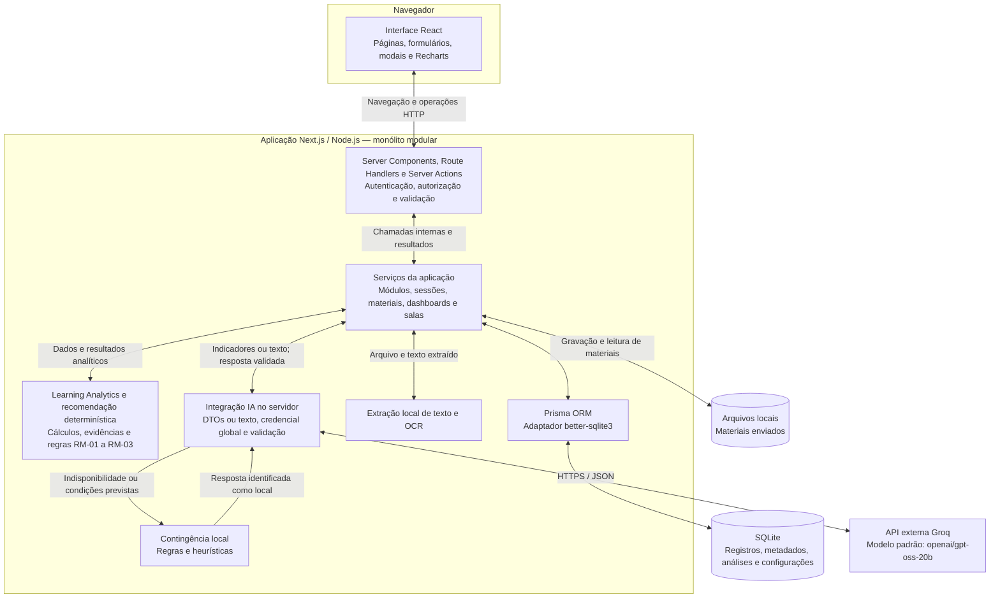

# Arquitetura do sistema — TCC

Data da análise: 18/10/2026.

Este relatório descreve a implementação atual, verificada no código-fonte. Não representa uma proposta de arquitetura futura. Nenhum código da aplicação foi alterado e nenhuma chamada à API de IA foi realizada para produzir este documento.

## 1. Tipo de arquitetura

A plataforma utiliza uma **arquitetura de monólito modular, com separação lógica de responsabilidades**. O front-end e o back-end pertencem à mesma aplicação Next.js e ao mesmo repositório. As funcionalidades são organizadas em módulos e camadas, mas não constituem microsserviços independentes.

O servidor da aplicação executa em Node.js. Ele concentra autenticação, autorização, operações de negócio, processamento analítico, acesso ao banco e integração com a IA. A Groq é um serviço externo consumido pela aplicação, e não um microsserviço desenvolvido pelo projeto.

Essa organização permite manter interface, regras e persistência separadas no código sem exigir uma infraestrutura distribuída.

## 2. Organização dos componentes

| Componente | Localização principal | Responsabilidade |
|---|---|---|
| Interface | `src/app` e `src/componentes` | Páginas, formulários, modais, filtros e gráficos construídos com React e Next.js App Router. |
| Entradas do servidor | `src/app/api/**/route.ts` e arquivos `acoes.ts` | Receber requisições, executar ações de servidor e encaminhar operações aos serviços. |
| Serviços da aplicação | `src/servidor` | Consultar dados autorizados e coordenar módulos, sessões, materiais, salas, análises e IA. |
| Regras de domínio | `src/dominio` | Aplicar cálculos analíticos, regras de recomendação e validações fora dos componentes da interface. |
| Acesso aos dados | `src/biblioteca/prisma.ts` e cliente gerado em `src/gerado/prisma` | Consultar e atualizar o banco por meio do Prisma e do adaptador `better-sqlite3`. |
| Estrutura do banco | `prisma/schema.prisma` e `prisma/migrations` | Definir entidades, relacionamentos e evolução do banco SQLite. |
| Integração com IA | `src/servidor/ia` | Preparar entradas, recuperar a credencial global, chamar a Groq, validar respostas e tratar indisponibilidade. |
| Armazenamento de materiais | `.dados/arquivos-materiais` | Guardar localmente os arquivos enviados; seus metadados e vínculos ficam no banco. |

### Front-end

O front-end combina componentes renderizados no servidor com componentes interativos executados no navegador. As páginas no servidor carregam os dados autorizados e os fornecem à interface. Os componentes de cliente cuidam de interações como preenchimento de formulários, abertura de modais e solicitações de interpretação.

Os gráficos utilizam Recharts. A biblioteca apresenta os resultados, mas não é responsável pelas regras oficiais das métricas de aprendizagem.

### Back-end

O back-end está incorporado ao Next.js, utilizando Route Handlers e Server Actions. Não há um segundo servidor de API separado, como uma aplicação Express ou NestJS.

Os serviços verificam permissões e utilizam o identificador do usuário autenticado para delimitar consultas e operações. Nas salas, o acesso também depende dos vínculos e das regras de compartilhamento implementadas no servidor.

### Banco e arquivos

O banco é **SQLite**, acessado por meio do **Prisma ORM**, com o adaptador `@prisma/adapter-better-sqlite3`. Ele mantém usuários, módulos, sessões, materiais e seus metadados, conceitos, evidências de aprendizagem, salas, vínculos e configurações da IA.

Os arquivos de materiais são armazenados no sistema de arquivos do servidor, e não como conteúdo binário no banco. A foto de perfil possui tratamento diferente: sua imagem normalizada é armazenada no registro do usuário e disponibilizada por uma rota autenticada.

## 3. Como os componentes se comunicam

Há dois caminhos principais entre interface e servidor:

1. **Carregamento das páginas:** um Server Component chama diretamente os serviços TypeScript no servidor, recebe os dados e compõe a página. Essa chamada interna não precisa passar por uma API REST.
2. **Interações no navegador:** componentes de cliente enviam requisições às rotas `/api/...` ou acionam Server Actions. O servidor valida a entrada, verifica a autorização, executa o serviço e devolve o resultado ou atualiza os dados apresentados.

Os serviços acessam o SQLite por meio do Prisma. As funções de domínio recebem os dados necessários e devolvem resultados aos serviços; elas não constituem processos separados nem acessam a Groq diretamente.

Quando há necessidade de IA, o próprio servidor envia uma requisição HTTPS à API da Groq. A chave de acesso não é enviada ao navegador.

## 4. Onde são processados Learning Analytics e recomendações

### Métricas

O processamento ocorre **no servidor**, em duas partes:

- Os serviços, como `src/servidor/metricas.ts`, `dashboard-observacional.ts` e `aprendizagem-modulo.ts`, consultam os registros pertinentes ao usuário, módulo e período.
- As funções em `src/dominio/analises` aplicam as regras de cálculo, filtragem, suficiência de evidências e agregação dos indicadores.

Entre os resultados estão tempo e frequência de estudo, compreensão e dificuldade relatadas, evolução temporal e análises por métodos, formatos e conceitos, conforme os dados disponíveis. Evidências de desempenho são consideradas quando existem e atendem às regras implementadas.

O fluxo é:

**Registros no SQLite → consultas autorizadas → cálculos de domínio → resultados para dashboards e análises.**

As salas reutilizam a base analítica por meio dos serviços de compartilhamento e painéis, respeitando as restrições de acesso e de apresentação dos dados.

### Recomendações

As recomendações de materiais são produzidas por **regras determinísticas e explicáveis**, implementadas em `src/dominio/analises/recomendacoes-materiais.ts` e coordenadas por `src/servidor/aprendizagem-modulo.ts`.

As regras RM-01, RM-02 e RM-03 consideram indicadores por conceito e a existência de materiais elegíveis do próprio módulo. Elas podem indicar um material, informar a ausência de material correspondente ou recomendar exploração quando as evidências são insuficientes.

Portanto, o recomendador de materiais **não depende de um modelo de aprendizado de máquina para executar suas regras**. A IA pode acrescentar interpretações e sugestões textuais, mas não deve ser confundida com o cálculo dos indicadores ou com esse recomendador.

As análises são observacionais: não demonstram causalidade e não classificam o estudante em um estilo fixo de aprendizagem. A qualidade dos resultados também depende dos registros e das informações extraídas dos materiais.

## 5. Integração com a Inteligência Artificial

### Provedor, modelo e configuração

O único provedor externo ativo no código atual é a **Groq**. O modelo padrão da aplicação é `openai/gpt-oss-20b`, definido em `src/servidor/ia/catalogo-provedores.ts`. Ele pode ser substituído pela variável `GROQ_MODEL`; na configuração local consultada, essa variável não estava definida, de modo que se aplica o padrão.

Esse é o modelo padrão da aplicação, não necessariamente o modelo selecionado explicitamente em execuções experimentais anteriores do TCC.

A integração utiliza `fetch` no servidor e o endpoint `https://api.groq.com/openai/v1/chat/completions`. O protocolo é compatível com OpenAI, mas o provedor utilizado continua sendo a Groq.

A configuração da credencial é global e administrada exclusivamente pela conta ADMIN. A chave é armazenada cifrada e utilizada pelo servidor para atender às funcionalidades de IA dos demais usuários, mantendo o isolamento dos dados de cada solicitação.

### Fluxo A — Interpretação de indicadores

1. O servidor obtém as métricas já calculadas e monta um objeto de transferência de dados, ou DTO.
2. Esse objeto, acompanhado das instruções de interpretação, é enviado à Groq.
3. A resposta estruturada é validada antes de ser apresentada ao usuário.

No contexto pessoal e do módulo, a entrada também pode conter descrições recentes de sessões, com limites de quantidade e tamanho. Na interpretação de membros das salas, o código utiliza os dados compartilhados autorizados e não inclui essas descrições privadas de sessões.

A implementação principal está em `src/servidor/ia/interpretacoes.ts`. As interpretações solicitadas na interface não são persistidas como um histórico de respostas no banco.

### Fluxo B — Análise de materiais

1. O material enviado é armazenado localmente e tem seus metadados registrados no banco.
2. O servidor extrai o texto do arquivo, utilizando leitores locais e OCR quando aplicável.
3. O texto extraído, sujeito aos limites implementados, pode ser enviado à Groq para análise.
4. O resultado validado é persistido como análise do material, incluindo resumo, conceitos e outros campos estruturados, com identificação da origem e do modelo quando disponíveis.
5. O serviço sincroniza os conceitos e registra evidências utilizáveis conforme as regras implementadas.

Esse fluxo é coordenado por `src/servidor/analises-materiais.ts`, com extração em `src/servidor/extracao-materiais.ts` e integração em `src/servidor/ia/analise-materiais.ts`.

Assim, não seria correto afirmar que a IA recebe somente indicadores numéricos: na análise de materiais ela recebe texto extraído dos arquivos.

### Validação e contingência

A aplicação possui validação de entradas e saídas estruturadas com Zod, limites de uso e tratamento de falhas. Sem credencial disponível, diante de determinadas falhas ou de dados insuficientes, os fluxos podem utilizar respostas locais baseadas em regras ou heurísticas. Não há troca para Gemini ou Qwen.

Essa contingência não é outro modelo externo nem uma geração real da Groq. Sua origem deve ser distinguida nas avaliações do TCC. A validação automática da estrutura também não substitui a avaliação qualitativa humana do conteúdo.

A análise de materiais é acionada por requisições da aplicação, inclusive para itens pendentes. Não há infraestrutura separada de fila distribuída ou de microsserviço de processamento.

## 6. Diagrama da arquitetura em Mermaid

O diagrama apresenta componentes lógicos. Os blocos dentro do servidor pertencem à mesma aplicação, não a serviços implantados separadamente. As setas de ida e volta representam solicitações e resultados.

## 7. Texto sugerido para o TCC

> A plataforma foi desenvolvida em TypeScript, utilizando Next.js e React, e adota uma arquitetura de monólito modular com separação lógica entre interface, serviços de aplicação, regras de domínio e persistência. O front-end e o back-end integram a mesma aplicação. A interface apresenta formulários, módulos de estudo e painéis gráficos, enquanto o servidor executa autenticação, autorização, operações de negócio e processamento analítico. Os dados são persistidos em SQLite por meio do Prisma ORM, e os arquivos de materiais são mantidos no armazenamento local do servidor.
>
> As métricas de Learning Analytics são calculadas no servidor por funções de domínio a partir dos registros de estudo e das evidências disponíveis. A recomendação de materiais utiliza regras determinísticas e explicáveis, considerando indicadores por conceito e os materiais vinculados ao módulo. Complementarmente, a aplicação integra a API da Groq para interpretar indicadores e analisar textos extraídos de materiais. As solicitações à IA são realizadas exclusivamente pelo servidor, com credencial global administrada pela conta ADMIN, validação das respostas estruturadas e mecanismos de contingência local. As interpretações são apresentadas com caráter observacional e não substituem os cálculos analíticos implementados.

## 8. Fontes verificáveis no projeto

| Aspecto | Arquivos de referência |
|---|---|
| Composição do dashboard | [Página do dashboard](../../src/app/dashboard/page.tsx) |
| Autenticação e autorização | [Autenticação](../../src/servidor/autenticacao.ts) e [autorização](../../src/servidor/autorizacao.ts) |
| Persistência | [Cliente Prisma](../../src/biblioteca/prisma.ts) e [schema](../../prisma/schema.prisma) |
| Métricas de sessões | [Serviço](../../src/servidor/metricas.ts) e [cálculos](../../src/dominio/analises/metricas-sessoes.ts) |
| Dashboard observacional | [Serviço](../../src/servidor/dashboard-observacional.ts) e [domínio](../../src/dominio/analises/dashboard-observacional.ts) |
| Aprendizagem e recomendações | [Serviço do módulo](../../src/servidor/aprendizagem-modulo.ts) e [recomendador](../../src/dominio/analises/recomendacoes-materiais.ts) |
| Salas | [Serviços das salas](../../src/servidor/salas.ts) e [painéis](../../src/servidor/paineis-salas.ts) |
| Provedor e modelo | [Catálogo](../../src/servidor/ia/catalogo-provedores.ts), [Groq](../../src/servidor/ia/groq.ts) e [cliente HTTP](../../src/servidor/ia/openai-compativel.ts) |
| Configuração global | [Configurações da IA](../../src/servidor/ia/configuracoes.ts) |
| Interpretação e contingência | [Interpretações](../../src/servidor/ia/interpretacoes.ts) e [resposta local](../../src/dominio/interpretacoes/resposta-local.ts) |
| Materiais e extração | [Análises](../../src/servidor/analises-materiais.ts), [extração](../../src/servidor/extracao-materiais.ts) e [análise com IA](../../src/servidor/ia/analise-materiais.ts) |

Verificação realizada: inspeção estática dos arquivos e fluxos relacionados. Não foram executadas gerações de IA, migrações ou alterações em dados. Como a entrega é documental, não foram executados build ou testes funcionais da aplicação.
