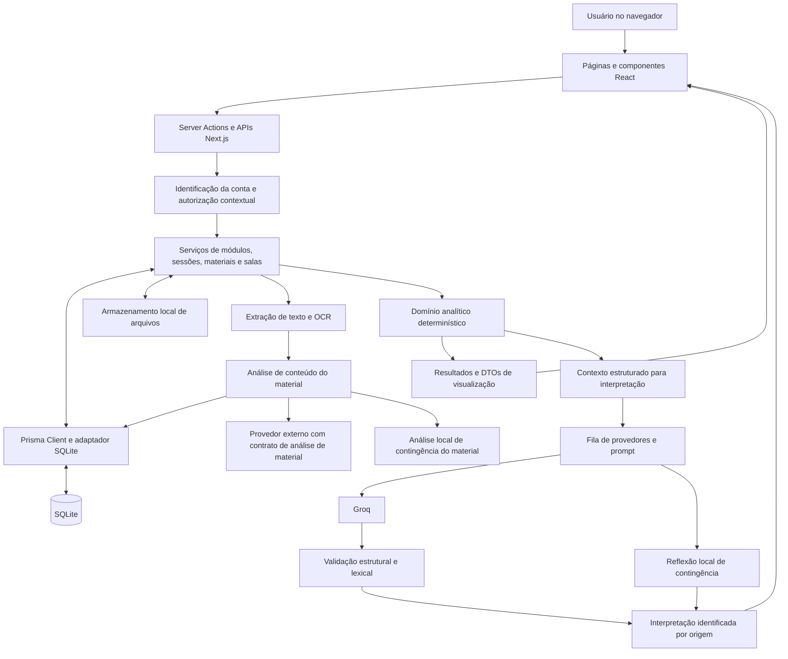

# Documentação do desenvolvimento e dos resultados para o Capítulo 4 do TCC

**Data de referência:** 13 de outubro de 2026, America/Sao_Paulo.  
**Responsável pela análise:** agente Guanabara, selecionado nesta sessão.  
**Objeto:** implementação presente na árvore de trabalho de `C:\Codigos\TCC`, incluindo alterações locais ainda não commitadas.  
**Natureza:** levantamento técnico e material de apoio à redação; não substitui o texto original do TCC.

## Critério de leitura e proveniência

Foram confrontados código, composição das páginas, schema, testes, scripts e resultados persistidos. Os relatórios anteriores serviram de apoio, com prioridade para o código atual. As referências de linhas são aproximadas e correspondem ao estado inspecionado; os nomes das funções permitem reencontrar os trechos após futuras edições. Os caminhos são relativos à raiz do projeto. A tabela da seção I.9 concentra a rastreabilidade das afirmações das demais seções.

São distinguidos quatro estados: **implementado e utilizado** (há chamada no fluxo atual); **implementado sem uso confirmado na interface atual** (existe serviço, contrato ou componente, mas não está montado nas páginas examinadas); **parcialmente implementado** (há infraestrutura, mas falta uma etapa necessária para a conclusão pretendida); **não implementado no fluxo atual** (não foi encontrado o recurso alegado). Disponibilidade no código não demonstra adoção por usuários nem eficácia pedagógica.

Esta tarefa produziu somente este relatório. Não foram alterados código-fonte, banco, seed, migrações, configuração, memória do projeto ou texto do TCC. Não houve captura de tela nem chamada externa de IA. Foram executados testes Vitest, lint e checagem de tipos, sem executar scripts de integração que escrevem no banco. As execuções anteriores são identificadas como registros históricos, não como novas execuções desta análise.

# PARTE I — Levantamento técnico e evidências

## 1. Resumo executivo

A solução concretizada é um laboratório pessoal de aprendizagem: uma aplicação web que organiza registros de estudo por conta e módulo, reúne materiais e conceitos, registra sessões e compara autorrelatos com resultados de evidências. Seu núcleo analítico é determinístico. A IA acrescenta interpretações textuais sob demanda e também participa de um fluxo distinto de análise de conteúdo de arquivos. O compartilhamento acontece por salas, mediante vínculo entre um módulo pessoal e um módulo da sala, com permissões específicas.

A conta pessoal é o centro do fluxo. Embora o banco conserve entidades e enumerações de aluno, professor, administrador, turmas e matrículas, as páginas antigas `/aluno`, `/professor`, `/administrador` e `/painel` redirecionam para `/dashboard`. A descrição do Capítulo 4 deve se concentrar na jornada pessoal e nos papéis de proprietário e membro de sala, sem apresentar aqueles redirecionamentos como painéis profissionais ativos.

### 1.1 Fluxo principal efetivamente disponível

1. A pessoa cadastra nome, senha e confirmação, ou entra com identificador e senha. O servidor deriva um nome de usuário normalizado e identifica a conta por cookie de demonstração.
2. Em Módulos, cria um rascunho e define título e descrição. O módulo publicado passa a organizar materiais e sessões.
3. Em **Sessões e Materiais**, envia arquivos classificados como Material, Avaliação, Anotação ou Evidência visual. O sistema armazena o arquivo e, nos formatos suportados, processa seu texto, conceitos e eventual resultado percentual.
4. Registra uma sessão manual ou inicia um cronômetro, informa descrição, métodos, formatos e materiais opcionais; ao concluir, registra compreensão e dificuldade percebidas. Datas futuras no registro manual representam planejamento.
5. Consulta o dashboard do módulo e a linha do tempo. Um filtro temporal pode delimitar a base consultada. O dashboard pessoal reúne resultados dos módulos ativos.
6. Solicita interpretação por IA. O servidor monta o contexto a partir de cálculos locais; a interface apresenta a origem e eventual contingência.
7. Opcionalmente, cria uma sala ou entra por código. Como membro, vincula ou cria uma instância pessoal e escolhe se autoriza comparação e uso de IA. O proprietário consulta os painéis permitidos.

Esse fluxo permite registrar, acompanhar e comparar experiências. Não comprova aumento de aprendizagem, autonomia ou eficácia dos métodos.

### 1.2 Páginas e alcance atual

| Página | Conteúdo confirmado | Observação |
|---|---|---|
| `/entrar` | Entrada e cadastro pessoal | Identificador/senha; não há login Google montado |
| `/dashboard` | Sínteses pessoais, gráficos, consistência entre módulos, base das análises, filtro e painel lateral de IA | Dados da conta e de módulos ativos |
| `/modulos` | Biblioteca de módulos e criação de rascunho | Arquivamento preserva registros |
| `/modulos/[identificador]` | Configuração do rascunho ou sub-abas Dashboard, Linha do tempo, Sessões e Materiais | Identificador é resolvido junto com a conta |
| `/desafios` | Catálogo de seis métodos de estudo | Não monta gerenciamento de desafios nem ativação de métodos |
| `/salas` | Criação, entrada por código e biblioteca de salas da conta | Sala não fica pública para todas as contas |
| `/salas/convite/[codigo]` | Entrada pelo convite | Código válido permite entrada imediata |
| `/salas/[identificador]` | Módulos da sala, vínculos, permissões, comentários e painéis conforme papel | Dashboards de terceiros restritos ao proprietário |
| `/configuracoes/ia` | Configuração e operações de provedores | Credenciais não são devolvidas em texto pela listagem segura |
| `/perfil` | Nome, e-mail sintético opcional e troca de senha | Identificador da conta permanece fixo |

A página global `/historico` foi removida. O histórico consultável permanece nos módulos. Nem a presença de uma função de listagem global no servidor nem um documento antigo restabelecem aquela tela.

## 2. Arquitetura implementada

### 2.1 Concretização da separação de responsabilidades

O sistema é um monólito modular em Next.js, com frontend e operações de servidor no mesmo projeto. Páginas de servidor obtêm a conta autenticada e chamam serviços; componentes de cliente realizam interação, submissões e gráficos. Não existe um backend separado implantado em outro serviço no código examinado.

| Camada/diretório | Responsabilidade concreta | Exemplo |
|---|---|---|
| `src/app` | Rotas, páginas, Server Actions e Route Handlers | Página do módulo combina três consultas; API de sessões traduz erros em HTTP |
| `src/componentes` e componentes locais das páginas | Visualização, formulários, estados e interação | Gráficos Recharts e painel de interpretação |
| `src/servidor` | Autorização contextual, validação de entrada, consultas, transações e orquestração | `sessoes.ts`, `salas.ts`, `aprendizagem-modulo.ts` |
| `src/dominio/analises` | Cálculos em funções testáveis, independentes da renderização | `calcularMetricasSessoes`, `analisarAprendizagemModulo` |
| `src/dominio/interpretacoes` | Contrato da saída e reflexão local de contingência | Zod, restrições lexicais e `gerarRespostaLocal` |
| `src/servidor/ia` | Contexto, prompts, provedores, credenciais e fila | `interpretarComFila` e adaptadores HTTP |
| `src/biblioteca/prisma.ts` e `src/gerado/prisma` | Cliente de acesso ao banco | Prisma com adaptador `better-sqlite3` |
| `prisma` | Schema, migrações e cenários reproduzíveis | Seed geral e carga compartilhada S1–S5 |
| `scripts`, `testes/fixtures` | Verificadores de integração e gabaritos experimentais | Protocolo TCC isolado e fixture independente |

As páginas consultadas encaminham acesso aos dados aos serviços. Estes convertem relações Prisma em entradas analíticas e DTOs. Por exemplo, o serviço de aprendizagem resolve conceitos e seleciona evidências; o domínio calcula médias e padrões; o componente apenas recebe o resultado e o apresenta. Essa divisão permite testar as regras sem navegador nem banco real.

### 2.2 Tecnologias confirmadas

O ambiente instalado consultado contém Next.js **16.3.3**, React **19.2.8**, TypeScript **5.9.3**, Prisma **7.10.0**, Recharts **3.10.1**, Tailwind CSS **4.3.3** e Vitest **4.1.11**. São versões locais, não uma afirmação sobre as versões mais recentes disponíveis. `package.json` declara intervalos que podem diferir da resolução instalada. A apresentação usa também CSS Modules, CSS global e ícones Lucide; não deve ser descrita como composta exclusivamente por utilitários Tailwind.

Zod valida contratos e entradas. O Vitest inclui testes em Node e testes que selecionam jsdom/Testing Library. PDFParse, Mammoth, `read-excel-file` e Tesseract dão suporte à extração local de arquivos. Os scripts de desenvolvimento e compilação usam Webpack explicitamente. Não foi necessária alteração de Next.js nesta tarefa.

### 2.3 Persistência e relacionamentos

SQLite é acessado pelo Prisma Client, gerado em `src/gerado/prisma`, com `PrismaBetterSqlite3`. A conexão usa `DATABASE_URL`; seu valor não é necessário para a documentação e não foi reproduzido. Arquivos são armazenados no sistema de arquivos por chave gerada; o banco mantém metadados e vínculos, não o conteúdo binário como campo do material.

| Entidades | Relação e consequência funcional |
|---|---|
| `Usuario` → `ModuloAprendizagem` | Cada módulo tem proprietário; identificador é único no contexto da conta |
| Módulo → `RecursoConteudo` | Materiais possuem função educacional, origem, formato, data e estado ativo |
| Material → `ArquivoMaterial`, `AnaliseMaterial` | Metadados do arquivo e estado/resultado persistido da análise são separados |
| Módulo → `SessaoEstudo` | Sessões têm usuário, início, término, duração, situação, percepções e arquivamento |
| Sessão → `MetodoSessaoEstudo`, `FormatoSessaoEstudo`, `MaterialSessaoEstudo` | Associações múltiplas, com chaves compostas que impedem repetir o mesmo vínculo |
| Módulo → `ConceitoAprendizagem` | Conceitos canônicos, aliases e chave normalizada no módulo |
| Conceito ↔ material/sessão/evidência/questão | Tabelas associativas sustentam a consolidação sem depender só do texto livre |
| `EvidenciaAprendizagem` → `QuestaoEvidencia` | Percentual global opcional e resultados por questão, quando extraíveis |
| Evidência ↔ sessão | Vínculos explícitos coexistem com associação temporal calculada |
| `Sala` → membros, convites, módulos, comentários | Proprietário controla a sala; código vincula outras contas |
| `VinculoModuloSala` | Relaciona membro e módulo pessoal ao módulo coletivo, com corte temporal e consentimentos |
| `EvidenciaHistoricaModuloSala` | Resumo de sessões preservado para agregado do módulo após desvinculação |
| `ConfiguracaoIa` | Credencial cifrada e estado por usuário/provedor |

Datas são representadas por `DateTime` no modelo e serializadas em ISO. Agrupamentos semanais e limites de datas dos filtros usam UTC. Algumas apresentações também usam explicitamente UTC; não afirmar que todos os indicadores estão automaticamente convertidos para o fuso local do estudante.

### 2.4 Comunicação e atualização

Server Actions tratam operações como configuração de módulos e salas; Route Handlers atendem sessões, arquivos e interpretações. Componentes enviam JSON ou `FormData` e recebem dados/erros. Ações de módulos invalidam caminhos com `revalidatePath`; componentes operacionais usam atualização do roteador após mudanças. As métricas são recalculadas nas consultas seguintes sobre a base persistida, sem tabela própria de indicadores acumulados no fluxo auditado. Isso permite refletir edições e invalidações, mas não representa atualização em tempo real por WebSocket.

### 2.5 Diagrama dos componentes

No ramo de materiais, o texto extraído é encaminhado ao serviço próprio de análise e validado por contrato próprio; ele não passa pelo mesmo DTO de interpretação dos dashboards. A seta de análise local representa uma alternativa à chamada externa. A autorização de sala ocorre antes da montagem de seu contexto.

## 3. Funcionalidades e regras de negócio

### 3.1 Autenticação e gerenciamento da conta

**Objetivo e uso.** Permitir entrada na conta pessoal e separação de registros. O cadastro exige nome de 2–80 caracteres, senha de 8–128 e confirmação idêntica; a normalização gera o identificador e duplicidades são tratadas como conflito. A entrada consulta esse identificador normalizado e confere a senha. Perfil permite alterar nome/e-mail sintéticos e trocar senha com verificação da senha atual.

**Implementação.** `cadastrarContaPessoal` aplica Zod e cria a conta; `criarHashSenha` usa scrypt com sal aleatório e `verificarSenha` usa comparação de tempo constante. `entrarComCredenciais` define a sessão e redireciona. `obterUsuarioAtual` lê o cookie e consulta `Usuario`; `exigirUsuario` redireciona entradas sem conta. APIs usam `autorizarUsuarioNaApi` e os serviços verificam propriedade com `usuarioId` e contexto do recurso.

**Limite relevante.** O cookie `usuario_demonstracao` contém diretamente o identificador do usuário, com `httpOnly`, `sameSite: lax` e caminho `/`. O trecho não implementa token assinado, sessão opaca persistida, expiração explícita ou atributo `secure`. As verificações de propriedade existem, mas dependem dessa identificação simplificada. Portanto, é autenticação de demonstração e não fundamento para afirmar segurança completa de produção. Não há autenticação Google ou confirmação de e-mail efetivamente montadas na entrada atual.

**Dados e contribuição.** A conta delimita a análise individual; hashes, e-mails ou identificadores técnicos não são necessários nas figuras do TCC. A contribuição demonstrável é a organização por conta e a autorização contextual, com a limitação descrita. **Situação:** implementado e utilizado no ambiente sintético. **Evidências:** R01–R03.

### 3.2 Módulos, conceitos e materiais

**Objetivo e uso.** O módulo delimita um assunto e reúne sua trajetória. A criação por rascunho permite definir nome e descrição antes do uso. Arquivar um módulo preserva seus registros e o retira das consultas analíticas ordinárias. Rascunhos não entram nas análises.

**Materiais.** O formulário atual recebe arquivo, função educacional e, quando aplicável, data. O título deriva do nome do arquivo; minutos estimados atribuídos internamente ao material não são duração observada de estudo. A biblioteca permite baixar, consultar resumo de análise, reprocessar, substituir, arquivar e excluir arquivos. Links/textos legados ainda podem ser apresentados se já persistidos, mas não são as opções do novo formulário de envio.

As funções são `REFERENCIA` (Material), `AVALIACAO`, `ANOTACAO` e `EVIDENCIA_VISUAL`. Elas não equivalem ao formato técnico: uma imagem pode exercer funções distintas. Material de referência usa o instante do envio; outras funções admitem data opcional com fallback. A validação verifica extensão, tamanho e compatibilidade do conteúdo; uma chave opaca separa o nome apresentado do caminho de armazenamento. O download consulta a propriedade do material no servidor.

**Conceitos.** No fluxo atual, são extraídos da análise de materiais e sincronizados no catálogo do módulo por `sincronizarConceitosMaterial`. A função normaliza termos, consolida aliases e siglas não ambíguas e atualiza vínculos do material. Não foi identificado formulário atual de cadastro manual independente de conceitos. As sessões podem ser relacionadas a conceitos por vínculos persistidos, conceitos de materiais associados e menções reconhecidas na descrição. Isso oferece contexto às análises sem afirmar reconhecimento semântico geral ou perfeito.

**Processamento.** PDF, TXT, DOCX, CSV, XLSX e imagens PNG/JPG/JPEG/WebP/GIF têm extração implementada; imagens usam OCR em português. O texto é limitado a 60.000 caracteres e marcado se truncado. Arquivo aceito para armazenamento não é necessariamente analisável. O estado da análise passa por pendente/processando/concluída, falha ou não suportada; abrir o módulo pode acionar processamento pendente no cliente. Não há evidência de uma fila externa de tarefas ou worker durável.

**Contribuição.** Módulos delimitam comparações; materiais e conceitos contextualizam sessões e evidências. O vínculo não demonstra domínio conceitual. **Situação:** módulos, upload e processamento implementados e utilizados; cadastro manual independente de conceito não implementado na interface examinada. **Evidências:** R04–R08.

### 3.3 Métodos de estudo e preservação histórica

O catálogo disponível para novos registros contém Técnica de Feynman, Recuperação ativa, Repetição espaçada, Pomodoro, Intercalamento e Prática distribuída. `/desafios` apresenta os seis métodos e orientações breves. A associação ao módulo ocorre por meio das sessões daquele módulo; não existe uma entidade atual de habilitação/desabilitação de método por módulo.

`validarContextoBasico` elimina repetições e aceita apenas métodos disponíveis para novos registros. A sessão pode conter vários métodos, e a análise os trata como contextos não exclusivos. Valores antigos, como Leitura ativa e Resumo, permanecem no enum e no formatador histórico. Isso preserva a leitura de registros antigos; não os transforma em opções novas. Como a edição valida o catálogo atual, não é correto prometer edição irrestrita de sessões com métodos legados.

Há serviços e APIs de desafios de experimentação, incluindo criação, cancelamento e referência por sessão. Cancelar um desafio muda sua situação e mantém vínculos históricos. Entretanto, a página atual não monta formulários de criação/cancelamento nem comparações desses desafios. **Ativação/desativação de métodos não está disponível como controle na interface atual**; cancelamento de desafio é uma operação distinta. O relatório não deve converter a existência desses serviços em um fluxo visual confirmado.

A contribuição demonstrável é registrar quais estratégias foram usadas e associá-las aos resultados observados, com histórico legível. **Situação:** catálogo e registro em sessão implementados e utilizados; serviços de desafio implementados sem uso confirmado na página atual. **Evidências:** R09–R11.

### 3.4 Sessões de estudo

**Objetivo e perspectiva de uso.** Registrar o episódio de estudo com seu contexto. O painel oferece modo manual e cronômetro. São informados descrição, ao menos um método e um formato, e materiais opcionais do próprio módulo. O histórico do módulo permite consultar, editar quando o estado admite e arquivar/desarquivar registros.

**Regras implementadas.**

- A descrição exige 3–2.000 caracteres; métodos têm limite de seis e formatos de doze na entrada. As listas são deduplicadas; materiais são verificados no módulo e na conta.
- Duração é a diferença entre início e término, em minutos inteiros com arredondamento para baixo. Término deve ser posterior ao início. Menos de cinco minutos gera situação `INVALIDADA` na conclusão.
- Registro manual inteiramente futuro é `PLANEJADA`, sem percepções; intervalo parcialmente futuro é rejeitado. Registro passado exige compreensão e dificuldade de 1 a 5.
- Cronômetro inicia uma sessão `ATIVA`; o serviço impede outra ativa e conflitos temporais com outros registros da conta. A conclusão informa percepções e observação opcional.
- Sessão planejada só pode ser concluída após seu término previsto, preservando o intervalo planejado. A edição ordinária contempla planejada, concluída e invalidada; não a sessão ativa.
- Se houver desafio associado, seu módulo e método devem corresponder. A edição não pode remover o método do desafio associado.
- Arquivamento é organização visual: sessões arquivadas válidas continuam nas métricas. Uma sessão ativa não pode ser arquivada.

**Dados e processamento.** `SessaoEstudo` guarda estados e percepções; tabelas associativas mantêm métodos, formatos e materiais. O serviço usa transações para criar/atualizar relações. APIs recebem a conta da sessão autenticada, não um proprietário escolhido pelo corpo da requisição. O componente atualiza a página após a operação; os serviços analíticos consultam os registros novamente.

As sessões alimentam tempo, frequência, regularidade e médias percebidas, além da associação contextual com evidências. Percepção é autorrelato; quantidade ou duração não mede aprendizagem. **Situação:** implementado e utilizado. **Evidências:** R12–R15.

### 3.5 Evidências de aprendizagem

O enum de tipos de evidência suporta `PROVA`, `EXERCICIO`, `AVALIACAO` e `OUTRA`, mas essa capacidade de persistência deve ser separada do fluxo atual de criação. Anotação e Evidência visual são funções de material, não valores desse enum. A rota ordinária de extração de desempenho é um **material de função Avaliação**. `registrarEvidenciaDoMaterial` exige material ativo e de propriedade da conta, e cria/atualiza uma evidência por `recursoId`. Não há, nas páginas examinadas, um formulário geral independente para lançar qualquer tipo de evidência e sua nota manualmente.

O percentual é extraído por expressão regular de termos como nota/resultado/desempenho seguidos de percentual explícito. Apenas 0–100 é aproveitado; texto sem percentual deixa `desempenhoPercentual` nulo. Não há inferência automática de nota a partir da qualidade da anotação, nem conversão geral de “7/10” em 70%. Questões são reconhecidas por padrões textuais de identificação e acerto/erro, deduplicadas por identificador; não há um motor atual de prova adaptativa ou correção pedagógica abrangente.

Os conceitos extraídos são vinculados à evidência e às questões. O vínculo de todas as questões aos conceitos do material é uma aproximação implementada, não uma classificação semântica individual comprovada de cada questão. Vínculos explícitos com sessões são suportados no modelo e usados nos cenários; na ausência deles, o motor analítico usa posterioridade temporal e conceito comum.

O campo de confirmação permanece no schema, mas o filtro atual de validade não exige confirmação humana. A inclusão requer percentual finito no intervalo permitido e data válida, além da seleção contextual do serviço. Evidências incompletas podem aparecer na linha do tempo com indicação de desempenho indisponível e ficam fora das médias. Arquivar o material ou mudar sua função retira sua evidência do conjunto elegível; substituir o arquivo invalida o percentual anterior até nova extração. O `upsert` impede que reprocessar um mesmo material acrescente duplicatas.

Anotações e evidências visuais podem gerar conceitos e eventos da trajetória; não recebem automaticamente um desempenho objetivo válido. A prova de conceito também injeta evidências `EXERCICIO` diretamente pela fixture, sem alegar que o usuário as lançou por uma tela inexistente.

Essa estrutura permite comparar autorrelato e resultado registrado, dentro dos limites de validade do resultado de origem. **Situação:** extração por material e análise implementadas e utilizadas; tipos adicionais e vínculos existem no modelo, com cobertura experimental; lançamento genérico independente não implementado na interface atual. **Evidências:** R07, R08, R16–R19.

## 4. Implementação do Learning Analytics

### 4.1 Pipeline de cálculo

O pipeline parte da consulta autorizada, seleciona dados do módulo/conta e período, converte as relações para entradas tipadas e chama funções do domínio. Os resultados alimentam dashboards, projeções de sala e contexto de IA. Não há treinamento de modelo preditivo ou classificação fixa de estilos de aprendizagem neste núcleo.

`obterMetricasSessoesModuloPessoal` e `obterMetricasSessoesPessoais` usam a seleção oficial de sessões. `obterAprendizagemModuloPessoal` acrescenta catálogo de conceitos, materiais ativos, evidências e relações; `analisarAprendizagemModulo` produz análises conceituais e contextuais; `calcularDashboardObservacional` consolida a conta. Essa cadeia evita que o gráfico e a IA implementem suas próprias médias oficiais.

### 4.2 Indicadores e critérios executáveis

| Indicador | Como foi integrado | Limite de interpretação |
|---|---|---|
| Quantidade e duração | Filtra concluídas, com término e duração inteira ≥5; soma duração e calcula média | Planejadas, ativas e invalidadas não contam; arquivadas contam |
| Frequência | Dias distintos e maior sequência a partir do término em UTC | Dias sem registro não revelam necessariamente ausência de estudo fora da plataforma |
| Regularidade | Semanas ativas sobre semanas entre a primeira e a última semana observada; classes descritivas | Menos de duas semanas é insuficiente; não mede disciplina como traço pessoal |
| Compreensão/dificuldade | Médias de sessões com ambas as percepções; mínimo de duas nas métricas oficiais | Escala 1–5; autorrelato, não desempenho |
| Evolução de atividade | Agrupa por semana iniciada na segunda-feira UTC | Pontos refletem as semanas presentes; não interpolam aprendizagem |
| Desempenho por conceito | Média de evidências válidas e distintas vinculadas ao conceito | Resultado de origem; sem controle comum da dificuldade das atividades |
| Tendência | Ordena evidências; compara última com primeira, com mínimo de três | Variação ≥10 pontos é evolução positiva; ≤−10 é atenção; não é regressão estatística |
| Percepção × evidência | Normaliza compreensão para 0–100 e compara patamares de 70 com ≥3 evidências | Alinhamento, possível super/subestimação ou atenção; não diagnóstico |
| Métodos/formatos × resultados | Associa sessões a evidências posteriores e deduplica por evidência em cada contexto | Contextos coexistem; não há atribuição causal ou exclusividade |
| Duração com resultados de referência | Seleciona sessões com compreensão ≥4/5 e média de evidência posterior ≥70% | Média observada daquelas sessões; não duração ótima prescrita |
| Contexto de maior compreensão | Ordena médias percebidas com ao menos três compreensões | Destaque descritivo; não superioridade de método/formato |
| Destaques por conceito | Janela de 90 dias, ≥2 observações, até cinco itens por índice | Índices exploratórios; podem usar apenas sinais disponíveis |
| Consistência entre módulos | Proporção de módulos positivos entre analisáveis por método | Módulo analisável exige ≥3 compreensões e ≥3 evidências; positivo exige 4/5 e 70% |
| Recomendações | Regras RM-01 a RM-03 sobre conceitos e materiais elegíveis | Sugestão exploratória, com amostra, justificativa e limitação |

Referências: R14–R23. Os limiares são opções implementadas no artefato, não parâmetros psicométricos externamente validados.

### 4.3 Associação de sessão e evidência

`evidenciasPosterioresDaSessao` exige que a evidência ocorra depois do encerramento. Se a evidência possui qualquer vínculo explícito, somente sessões presentes nessa lista são associadas; o vínculo explícito prevalece sobre a aproximação temporal. Sem vínculos explícitos, exige conceito comum e intervalo de até 30 dias.

Para cada método ou formato, o agrupamento usa `Set` de sessões e `Map` de evidências por identificador. Uma evidência associada a várias sessões do mesmo contexto entra uma vez em sua média. Uma mesma evidência pode aparecer em contextos diferentes, pois métodos e formatos não são tratamentos exclusivos. Somar as amostras desses contextos não equivale ao número global de evidências únicas. O conjunto total de sessões deve chegar sem duplicações ao motor; não existe deduplicação universal de todos os campos em qualquer entrada arbitrária de `calcularMetricasSessoes`.

S1 ilustra um confundimento intencional: método, formato e ordem temporal mudam juntos. Observar 80% em Feynman/texto e 40% em Pomodoro/vídeo não permite atribuir a diferença isoladamente ao método ou ao formato.

### 4.4 Índices e ausência de informação

Os índices de dificuldade e compreensão normalizam as percepções e combinam os sinais disponíveis com desempenho ou seu complemento. A implementação calcula uma média dos sinais presentes; dados ausentes não viram automaticamente zero. A janela de destaque exige ao menos duas observações, contando sessões com percepção e evidências válidas; o campo `evidenciasSuficientes` continua informando se há ao menos três evidências.

Consequentemente, um conceito pode integrar um destaque exploratório com poucas evidências ou só com autorrelato. O índice não deve ser apresentado como proficiência validada. O mesmo conceito pode figurar nas duas listas, porque são ordenações independentes e não classes mutuamente excludentes.

Os limiares variam por finalidade: duas percepções para médias oficiais de sessão; três evidências para tendência e comparação conceitual; três compreensões para destacar um método/formato; duas observações para índice conceitual. A evolução semanal percepção × evidência do domínio conceitual usa médias dos valores disponíveis e não repete necessariamente o mínimo de duas percepções usado pelo gráfico pessoal de autorrelato. Não há um único limiar universal de “dados suficientes”.

### 4.5 Recomendações determinísticas e separação da IA

`recomendarMateriais` prioriza conceitos com desempenho abaixo de 70%, compreensão abaixo de 3 ou dificuldade ≥3. Seleciona até três conceitos e procura materiais de referência ativos, da mesma conta e módulo, associados ao conceito, sem repetir material selecionado. A saída registra regra, material/conceito/módulo, indicadores, amostra, justificativa e nível de evidência.

RM-01 indica material elegível; RM-02 informa ausência de material; RM-03 orienta exploração quando não há sinal suficiente para seleção. Com menos de três evidências o nível é limitado. A ordenação por identificador de material é determinística e não estima sua qualidade pedagógica. O dashboard também calcula cobertura de métodos e possível exploração do menos registrado; a existência do campo calculado não significa que haja uma intervenção experimental em execução.

O motor de recomendação continua chamado pelo serviço de aprendizagem e seus resultados entram no DTO de módulo da IA. Contudo, `PainelRecomendacoesMateriais` não está montado na página atual: não descrever um card ativo de recomendações. A IA recebe orientações para explicar a decisão determinística, mas o servidor não compara semanticamente toda sugestão textual com essa decisão.

### 4.6 Recortes, atualizações e limitações de implementação

O filtro recebe datas na URL, valida ordem, existência e ausência de futuro e aplica dias inclusivos em UTC. Consultas de sessões recortam pelo início; evidências usam `dataEvento`; materiais da trajetória usam a data do evento ou criação. Esses eventos não compartilham necessariamente o mesmo instante. O serviço de aprendizagem restringe o contexto por usuário e módulo e não usa dados de outro módulo para completar uma amostra.

No dashboard pessoal, sem filtro explícito há distinção entre histórico e janela recente de 90 dias para certos sinais de atenção; a consistência e os resultados contextuais são consolidados das análises retornadas. Com período explícito, a base é delimitada pela consulta. Não chamar todo o dashboard de “últimos 90 dias” sem distinguir esses campos.

Os cálculos voltam a consultar as fontes após operações e atualização da página. Arquivar sessão preserva contribuição histórica; arquivar módulo o retira das consultas ordinárias; material inativo ou sem percentual válido deixa de alimentar desempenho elegível. O controle registrado no protocolo confirma entrada/retirada de uma evidência sem duplicação. Isso demonstra consistência para os casos testados, não integridade universal em qualquer corrupção externa do banco.

## 5. Dashboards e visualizações

### 5.1 Dashboard pessoal

`PaginaDashboard` obtém o período e chama `obterDashboardObservacionalPessoal`. O serviço consulta módulos ativos, sessões, materiais de arquivo com análise concluída e análises dos módulos. A página monta os seguintes elementos:

| Elemento atual | Fonte e organização | Interpretação e relevância para o TCC |
|---|---|---|
| Quatro sínteses | Método de maior compreensão; formato de maior compreensão; duração das sessões elegíveis; módulo de maior dificuldade percebida | Aproxima o usuário dos sinais observados, com estados de insuficiência |
| Evolução da percepção | Linhas semanais de compreensão/dificuldade de 1 a 5; mínimo de duas percepções no ponto | Demonstra acompanhamento do autorrelato, sem apresentá-lo como nota |
| Percepção × evidências | Anel de contextos comparáveis, com diferença até 15 pontos ou acima disso | Conta contextos de método/formato, não estudantes ou evidências únicas |
| Métodos × Resultados | Barras horizontais de compreensão normalizada e desempenho posterior | Expõe as duas fontes; valores vêm da consolidação por módulo |
| Formatos × Resultados | Mesma organização para formatos registrados | Permite explorar diferenças observadas com a mesma cautela |
| Consistência dos métodos | Tabela entre módulos e indicação de poucos dados | Menos de dois módulos analisáveis ou quatro evidências sinaliza poucos dados; cada módulo analisável já exige seu mínimo |
| Base das análises | Três valores: métodos registrados, sessões concluídas válidas, duração média | É a composição atual; a versão antiga com oito campos não está montada |
| Filtro e interpretação | Controles próximos; interpretação abre painel lateral e inicia geração | Mostra recorte contextual e interpretação sob demanda |

O anel usa um critério próprio de diferença absoluta de 15 pontos em contextos comparáveis, enquanto a classificação conceitual usa patamares de 70%. São sínteses diferentes; não usar os nomes como medidas equivalentes de calibração. Métodos e formatos entram juntos no anel e podem refletir sessões sobrepostas.

Os componentes incluem rótulos acessíveis e descrições textuais dos gráficos. Isso é evidência de implementação de acessibilidade, não uma certificação completa. Nesta tarefa não houve inspeção visual em navegador. R20–R25 sustentam a composição descrita.

### 5.2 Dashboard do módulo e trajetória

A página obtém módulo, métricas, sessões e aprendizagem, serializa datas e entrega resultados aos componentes. A sub-aba Dashboard monta `ConteudoDashboardModulo`: métricas/sínteses, resultados contextuais e destaques conceituais. `LayoutDashboardModulo` acomoda a interpretação em coluna própria no desktop.

`PainelMetricasSessoes` recebe métricas e resumo de aprendizagem, incluindo duração das sessões elegíveis, contexto com maior compreensão e evolução percepção × evidência. `PainelResultadosContextuais` compara métodos e formatos, com amostra e estados vazios. `PainelConceitosDestaque` organiza conceitos por dificuldade e compreensão exploratórias; a lista não é ranking de alunos.

Na composição que recebe aprendizagem, o painel usa três sínteses de duração/método/formato, gráfico semanal de percepção normalizada versus evidência, anel de regularidade e evolução de compreensão/dificuldade com suas médias e amostras. Existem tabelas expansíveis de evolução e percepções nessa composição. Quando não recebe aprendizagem, o mesmo componente tem uma apresentação alternativa de tempo estudado, duração média e evolução tempo/compreensão. A página pessoal atual fornece aprendizagem e, portanto, não se deve ilustrar a alternativa como sua composição ordinária. Isso também explica diferenças em agregados de sala que reutilizam o componente sem aquele resumo.

Linha do tempo reúne sessões, materiais e evidências por data e explicita resultados sem percentual utilizável. Sessões e Materiais é a área operacional, com biblioteca e painel de registros. São sub-abas da mesma unidade de estudo, com período compartilhado; a existência de uma evidência na trajetória não significa inclusão em todos os gráficos. Não há card de recomendações nem painel de confirmação de evidências montados na composição atual. R15, R18, R24 e R26 comprovam a organização.

### 5.3 Painéis de sala

O proprietário vê o dashboard geral quando há pelo menos três contribuidores elegíveis e, por módulo coletivo, agregado e painéis individuais autorizados. A composição individual reutiliza `ConteudoDashboardModulo` com projeção sanitizada; se o resumo não estiver disponível, apresenta o painel de métricas. O geral usa sínteses e gráficos do dashboard pessoal, sem montar sua tabela de consistência ou sua seção Base das análises.

Comparação individual recebe somente participantes com `permitirComparacao`. A IA aparece por vínculo com `permitirIa`; não foi encontrado botão de interpretação geral da turma equivalente ao fluxo individual. A distinção entre agregado atual e histórico do módulo é detalhada na seção seguinte. R27–R30.

## 6. Integração com Inteligência Artificial

### 6.1 Provedores e configuração efetivamente implementados

| Adaptador | Modelo padrão codificado | Configuração e alcance da afirmação |
|---|---|---|
| Groq | `openai/gpt-oss-20b` | `GROQ_MODEL` pode substituir o padrão |

O Groq é o único provedor externo ativo. O identificador vem do código ou de `GROQ_MODEL`; isso não confirma disponibilidade comercial nem prova chamada real. A configuração pessoal permite gerenciar chave, ativação e teste, sem editor livre de modelo por conta no fluxo inspecionado.

Credenciais pessoais são cifradas com AES-256-GCM e contexto associado a usuário/provedor. A listagem segura informa estado, sem devolver o segredo. `listarCredenciaisAtivas` também considera chaves do ambiente quando não há configuração pessoal elegível; por isso, desativar uma configuração pessoal não deve ser descrito como bloqueio absoluto de toda chamada se o ambiente oferece uma chave. Nenhuma credencial foi consultada ou transcrita para este relatório. R31–R33.

### 6.2 Solicitação e preparação do contexto

O componente chama, conforme o contexto, `/api/interpretacoes`, `/api/modulos/[identificador]/interpretacoes` ou a rota de interpretação do vínculo de sala. O servidor identifica a conta, obtém análises e monta o DTO. A solicitação ordinária produz uma resposta com um a três insights; não gera três respostas experimentais a cada clique.

| Contexto | Dados encaminhados | Dados ausentes/restrições |
|---|---|---|
| Pessoal | Contagens, minutos, resumo por módulo, frequência, percepções, métodos/formatos, evolução semanal e descrições de sessões | Não usa o mesmo detalhamento conceitual e de recomendações do DTO do módulo |
| Módulo | Métricas de sessão; conceitos, evidências válidas, tendências, relação percepção × evidência, associações, padrões, eventos recentes, evolução e recomendações determinísticas | Restringe ao módulo e período; não inclui toda a base bruta nem arquivos binários |
| Membro da sala | Resumo autorizado de métricas do vínculo e evolução | Sem descrições de sessões nem materiais; exige proprietário autorizado e consentimento de IA |

Referências opacas como “Módulo 1” reduzem identificadores diretos nos DTOs pessoais, mas descrições são texto livre e nomes de conceitos/eventos podem revelar conteúdo. No DTO de sala, o resumo inclui nome do membro e título coletivo. Não declarar anonimização total das entradas ou equivalência dos três contextos.

Descrições são delimitadas como dados não confiáveis. Antes de chamar provedor, o contexto é compactado: mantém até 12 semanas, subconjuntos de conceitos/associações/padrões/eventos e descrições recentes truncadas. Se o JSON ainda ultrapassar 50.000 caracteres, usa contingência. Essas medidas reduzem volume e orientam contra instruções injetadas, sem garantir neutralização semântica de todo texto malicioso. R34–R36.

### 6.3 Divisão entre cálculo e geração textual

`criarInstrucaoInterpretacao` incorpora o DTO ao prompt `interpretacao-aprendizagem-v1`. O prompt informa que médias, contagens, tendências e níveis de amostra já foram calculados; proíbe recálculo, invenção, causalidade, diagnóstico e estilo fixo, e orienta preservar recomendações oficiais. O domínio e o servidor calculam os indicadores independentemente de resposta externa. A indisponibilidade da IA não impede consultar os dashboards.

Essa divisão é confirmada pelo fluxo: funções analíticas → DTO → prompt → adaptador. Porém, há duas ressalvas. Primeiro, o modelo ainda pode sugerir um experimento textual; ele não seleciona nem altera o objeto oficial de recomendação no banco, mas a coerência do texto não é integralmente validada. Segundo, análise automática de materiais é um fluxo diferente, no qual conceitos extraídos e sincronizados passam a contextualizar cálculos posteriores. Assim, a IA não calcula as médias oficiais, mas pode influenciar o contexto conceitual usado por elas.

### 6.4 Resposta, validação e apresentação

O contrato exige um a três insights com tipo, título, observação, campos de apoio/reflexão/experimento e confiança categórica. Adaptadores solicitam JSON; `extrairRespostaEstruturada` também aceita cerca Markdown e extrai o objeto; Zod verifica tipos, quantidades e limites textuais. `validarConteudoInterpretacao` rejeita um conjunto finito de expressões causais, diagnósticas, de superioridade de método ou classificação fixa.

A resposta válida do Groq encerra o fluxo externo. Não há votação, escolha da melhor resposta por escore ou validação por segundo modelo. O resultado inclui origem, modelo e tentativa; o componente apresenta o conteúdo e identifica resposta local quando houver. A confiança retornada é um rótulo do insight e não probabilidade calibrada de correção.

| Verificação | Existe? | O que permite afirmar |
|---|---|---|
| JSON, campos, tipos, tamanho, 1–3 insights | Sim | Há validação estrutural |
| Lista de frases proibidas | Sim | Há proteção lexical parcial |
| Conferência de todos os números contra o DTO | Não identificada | Não há garantia automática de fidelidade numérica |
| Detecção semântica geral de invenções/contradições | Não identificada | Não há detector completo de alucinações |
| Coerência da recomendação textual com a oficial | Apenas orientação de prompt | Avaliação humana continua necessária |
| Julgamento automático do conteúdo em C1–C5 | Não | O código calcula classificação a partir de decisões humanas preenchidas |

### 6.5 Falhas e contingências

Ausência de dados, chave, cota ou resposta externa válida aciona `gerarRespostaLocal`, uma reflexão determinística sobre o DTO. A cota de interpretação é de cinco solicitações por hora por usuário, mantida em memória do processo, sem coordenação distribuída ou persistência. Erros externos distinguem autenticação, cota, rede, timeout, modelo/requisição inválidos e resposta inválida; qualquer falha do Groq segue diretamente para a contingência local, e estados/bloqueios temporários da configuração podem ser registrados. Uma contingência bem-sucedida pode retornar HTTP 200, com origem local, sem representar sucesso do modelo externo. Não foi identificado histórico persistente de interpretações ordinárias do aplicativo. O corpus experimental em JSON, implementado separadamente, conserva respostas de avaliação e não constitui histórico geral da aplicação. R35–R39.

### 6.6 Análise de materiais: integração complementar

`analisarTextoMaterial` envia texto extraído, marcado como não confiável, a um contrato próprio de resumo, conceitos, pontos de revisão, métodos sugeridos, próximas sessões e perguntas. Há limite de dez usos externos por hora por usuário em memória e timeout de requisição; falhas recorrem a `gerarAnaliseMaterialLocal`. O resultado, origem, modelo, truncamento e hash do conteúdo são persistidos em `AnaliseMaterial`.

O desempenho percentual é extraído deterministicamente do texto por outro serviço; a IA não deve atribuir nota. A biblioteca atual monta resumo e estado da análise; vários campos persistidos não são exibidos integralmente. Portanto, não apresentar todos os campos do schema como se fossem painéis visíveis. OCR também pode produzir erros que afetam extração; não há conferência humana obrigatória antes de todo percentual válido entrar nas métricas. R06–R08 e R40.

## 7. Salas e compartilhamento

### 7.1 Criação, convite e vínculo

Uma conta pode criar sala, tornando-se proprietária. O proprietário gera código com expiração de sete dias e pode revogá-lo. O banco guarda hash do código. `entrarSalaComCodigo` verifica validade, expiração e situação e cria/reativa a associação em transação; a entrada é imediata, não depende de aprovação manual. Solicitações antigas pendentes podem ser encerradas como aprovadas no mesmo processo; a entidade de solicitação preservada não é evidência de um fluxo atual de aprovação docente.

A sala nasce com o proprietário como membro e um primeiro módulo coletivo definido na criação. O serviço admite até cinco módulos coletivos ativos. O membro pode criar uma instância pessoal a partir do módulo coletivo ou vincular um módulo próprio disponível. O vínculo não transfere propriedade dos materiais. Duplicidades por usuário/módulo coletivo e repetição do mesmo módulo pessoal na sala são restringidas. Uma reativação para o mesmo módulo estabelece `dadosDesde` e reinicia permissões opcionais, evitando retomar silenciosamente todo o histórico anterior.

### 7.2 Permissões e privacidade

| Regra | Comportamento confirmado |
|---|---|
| Adesão ao módulo | Ativa compartilhamento do dashboard no vínculo |
| Comparação | Começa desabilitada; membro pode autorizar separadamente |
| IA | Começa desabilitada; membro pode autorizar separadamente |
| Consulta de dashboards de terceiros | Exige proprietário da sala e vínculo compartilhável com membro ativo |
| Visibilidade dos pares | Não equivale ao acesso concedido ao proprietário; não há painel irrestrito de todos os colegas |
| Dados privados | Projeções descartam descrição de sessão e não enviam arquivos/materiais pessoais |
| Revogação | Parar de compartilhar, sair ou ser removido encerra vínculo e permissões |
| Corte temporal | `dadosDesde` delimita dados vivos do vínculo; há sutilezas de seleção por início/término nos fluxos históricos |

O campo `compartilharDashboard` está na infraestrutura, mas a interface de consentimentos altera comparação e IA; o controle para cessar o compartilhamento é a desvinculação. Não descrever três caixas independentes se a tela monta apenas duas. Comentários podem ser publicados nos escopos previstos com autorização; não substituem registros privados do módulo.

### 7.3 Agregados e preservação histórica

Agregados exigem pelo menos três contribuidores com registros elegíveis. O dashboard geral usa vínculos vivos de membros ativos e compartilháveis; não incorpora históricos de pessoas que saíram. O agregado do módulo coletivo também pode incorporar resumos históricos preservados. Os critérios de elegibilidade dos contribuidores e o filtro final de métricas não são uma prova formal de anonimato estatístico.

Ao desvincular, sair ou remover membro, `preservarEvidenciasHistoricas` grava somente duração, término, percepções, métodos e formatos de sessões válidas, com hashes de contribuinte e sessão. A chave de sessão e `upsert` evitam duplicação do mesmo resumo. A denominação histórica `EvidenciaHistoricaModuloSala` refere-se a **resumo de sessão**, não às evidências percentuais de `EvidenciaAprendizagem`.

Esses hashes oferecem pseudonimização estável no sistema; não comprovam anonimização irreversível. A retirada do painel individual não significa eliminar toda contribuição agregada histórica. Essa política deve ser explicada com precisão no TCC. Não afirmar que o mínimo de três garante anonimato, nem relatar conformidade jurídica integral a partir desses mecanismos.

A IA de membro verifica novamente proprietário, vínculo e `permitirIa` antes de montar contexto sem descrições e materiais. Os serviços de sala, projeções e testes existem; nesta tarefa a comprovação atual é por inspeção e testes unitários, com execuções de integração anteriores identificadas na seção I.8. R27–R30 e R41.

## 8. Testes e resultados disponíveis

### 8.1 Execuções desta análise

| Verificação executada nesta sessão | Resultado observado | Alcance |
|---|---|---|
| `node node_modules/vitest/vitest.mjs run --no-cache` | **46 arquivos; 170 testes aprovados**; duração informada: 38,17 s | Suíte configurada de domínio, servidor com mocks, componentes e contratos |
| `node node_modules/typescript/bin/tsc --noEmit --incremental false` | Código de saída 0 | Tipagem sem emissão e sem atualização incremental |
| `node node_modules/eslint/bin/eslint.js .` | Código de saída 0, sem diagnóstico | Análise estática, sem correção automática |

Não foram executados build, seed, migrações, scripts de integração, protocolo TCC com banco temporário ou chamadas externas. O build geraria artefatos e o comando `compilar` também chama geração Prisma; para uma entrega restrita ao relatório, a evidência anterior é apresentada separadamente. Os testes atuais não são testes reais de API de IA nem ensaio com participantes.

### 8.2 Tipos de teste e o que comprovam

| Grupo | Arquivos/verificadores existentes | Evidência disponível e limite |
|---|---|---|
| Cálculos de sessão | `src/dominio/analises/metricas-sessoes.test.ts` | Executado nesta suíte; filtros, médias, agrupamentos e amostras em entradas definidas |
| Conceitos e evidências | `aprendizagem-modulo.test.ts`, `ajustes-tcc.test.ts`, `src/servidor/aprendizagem-modulo.test.ts` | Domínio e consulta simulada executados; não equivalem a integração SQLite atual |
| Dashboard e sala | `dashboard-observacional.test.ts`, `dashboard-sala.test.ts`, `aprendizagem-sala.test.ts` | Consolidação e projeção sanitizada executadas em casos definidos |
| Conta e credencial | `contas.test.ts`, `senhas.test.ts`, `autenticacao.test.ts`, `cofre-credenciais.test.ts` | Regras e contratos cobertos; não auditoria completa de segurança de produção |
| Integração de conta/recursos | `verificar-autorizacao-apis.ts`, `verificar-servicos-modulos.ts`, verificadores de sessões/CRUD | Código e asserções inspecionáveis; não executados nesta tarefa, pois podem escrever no banco |
| Integração de salas | `verificar-servicos-salas.ts`, `verificar-dashboards-salas.ts` | Testam acesso, consentimento, históricos e cortes; há aprovação histórica no acompanhamento |
| IA com mocks | `interpretacoes.test.ts`, `insights-aprendizagem.test.ts` | Fila, contratos, erros, cota e contingência; não medem qualidade do provedor real |
| Interface | Testes de páginas/componentes e `interpretacao-automatica-modal.test.ts` | Renderização, interação e contratos em ambientes de teste; não navegação completa ponta a ponta |
| Rubrica experimental | `src/dominio/avaliacao-ia-tcc.test.ts` | Pendência, regras de aprovação e exportação; decisões de conteúdo continuam humanas |
| Cenários S1–S5 | `src/dominio/cenarios/cenarios-tcc.test.ts`, fixture e `scripts/avaliar-tcc.ts` | Fixture testada nesta suíte; execução integrada anterior documentada pelo JSON |

Não foi identificada suíte Playwright/Cypress configurada como teste automatizado completo de navegador. Testes de renderização e interação não devem ser chamados de E2E. Inspeções de navegador registradas anteriormente são manuais/assistidas e datadas; não foram repetidas agora.

O relatório `IMPLEMENTACAO_AVALIACAO_IA_TCC.md` e o acompanhamento registram validação integral anterior: scanner, lint, tipos, 46 arquivos/170 testes e build com 18 páginas. Isso é **registro histórico**, sem atribuir a esta tarefa uma nova compilação ou validar automaticamente toda a árvore local posterior.

### 8.3 Cenários sintéticos: base, execução e resultados

A fixture `testes/fixtures/cenarios-tcc.ts` fornece gabaritos aritméticos separados dos algoritmos; `aplicarCenariosAvaliacaoTcc` gera cinco usuários, três módulos por cenário e dez sessões/evidências por módulo. As sessões ocorrem de 1 a 10 de setembro de 2026, duram 30 minutos e alternam Feynman/texto nas cinco primeiras e Pomodoro/vídeo nas cinco últimas. A décima é arquivada e continua válida. As evidências ocorrem um minuto após a sessão e têm vínculo explícito. A referência analítica é 10/10/2026 às 12:00 UTC.

Cada módulo tem dez sessões, 300 minutos, média de 30 minutos e dez dias registrados na carga-base. Esses valores são deriváveis da carga; o quadro de `observados` persistido concentra média, tendência e quantidade de evidências do conceito-alvo, não uma captura visual desses indicadores na interface. Fora de S5, compreensão e dificuldade são 3/5. Todos os nomes e resultados pertencem a contas fictícias.

O arquivo `RESULTADOS_AVALIACAO_TCC.json` registra o experimento `mock-2026-10-13T00-32-07-821Z`, iniciado em **12/10/2026 às 21:32:07 no fuso America/Sao_Paulo** (`2026-10-13T00:32:07.821Z`). Os 15 registros de módulos possuem `aprovado: true`. Nesta tarefa o arquivo foi lido, não regenerado.

| Cenário e objetivo | Dados sintéticos | Esperado e observado no JSON, módulos 0/1/2 | Verificação e resultado | Limitação |
|---|---|---|---|---|
| **S1 — Métodos e formatos**, Ana Souza: conferir associações | Cinco resultados de 80% e cinco de 40% em cada módulo | Médias **60/60/60%**; dez evidências do alvo em cada; tendência de atenção nas três séries | Script afirma médias, tendências, n e Feynman **80%**/Pomodoro **40%**; três módulos aprovados | Método, formato e período variam juntos; não demonstra superioridade ou causalidade |
| **S2 — Contextos de módulo**, Bruno Lima: isolar contextos | Resultados constantes de 80%, 40% e 60% segundo o módulo | **80/40/60%**; dez evidências cada; três tendências estáveis | Script afirma médias, tendências, n e nega consulta por outra conta; três módulos aprovados | Não avalia transferência de aprendizagem entre contextos |
| **S3 — Evolução temporal**, Carla Rocha: distinguir trajetórias | 10→100%, 100→10% e dez resultados de 50% | **55/55/50%**; evolução positiva/atenção/estável; dez evidências cada | Script afirma médias e tendências; três módulos aprovados | Tendência compara extremos; não prova mudança causada por estratégia |
| **S4 — Dados insuficientes**, Diego Alves: respeitar amostra | Zero, uma e duas evidências do alvo; demais evidências vinculadas ao conceito Controle; sem material de referência | Média **ausente/50/50%**; **n=0/1/2** do alvo; insuficiência nas três tendências | Script afirma n, média, tendência e ausência de material recomendado; três módulos aprovados | Dez evidências físicas por módulo não são dez evidências do alvo; associações explícitas de sessão ainda podem existir |
| **S5 — Percepção versus desempenho**, Elisa Martins: comparar fontes | Compreensão/dificuldade 5/1, 1/5 e 3/3; desempenhos constantes 20%, 90%, 50% | **20/90/50%**, tendências estáveis; relação de possível superestimação/subestimação/atenção | Script afirma relações e índices de compreensão **73,333…/30/50**; três módulos aprovados | Relações são rótulos contextuais exploratórios, sem diagnóstico ou instrumento psicométrico validado |

As classificações S5 são confirmadas pelas asserções do script, mas não constam como campos próprios de cada registro de `observados`; não atribuir ao JSON detalhamento que ele não contém. Em S3 módulo 0, a tendência positiva permanece no conceito, enquanto a lista de padrões pode priorizar ponto de atenção pela ordem das condições de percepção/desempenho. Os dois campos não têm a mesma função.

### 8.4 Carga-base e controles posteriores

| Momento | Usuários | Módulos | Sessões físicas | Evidências físicas | Significado |
|---|---:|---:|---:|---:|---|
| Carga-base | 5 | 15 | 150 | 150 | Conjunto dos cinco cenários; contagem inicial afirmada pelo script |
| Após controles adicionais | 5 | 15 | 152 | 151 | Duas sessões excluídas das métricas e uma evidência adicional posteriormente incompleta |

O controle adiciona sessão de quatro minutos e sessão planejada, mantendo dez sessões válidas no módulo examinado. Testa também recorte de um dia; tentativa de registro por outra conta; extração repetida de “Resultado: 70%” em um material sem duplicação; inclusão da evidência válida sem confirmação; retirada ao desativar material; e exclusão analítica ao reprocessar texto sem resultado. A média do alvo passa temporariamente de 60% para `670/11 ≈ 60,91%` e a base válida volta a dez evidências após a retirada/incompletude.

O JSON conserva os controles como verdadeiros e as contagens finais. A contagem final é calculada e gravada, mas não recebe o mesmo `assert.deepEqual` específico das contagens iniciais. Esses 152/151 são totais físicos finais, não uma ampliação da carga planejada nem número de observações válidas para cada conceito.

O seed geral e o comando de aplicação compartilham a carga dos cenários, e os relatórios anteriores registram sua vinculação às contas nomeadas. Conteúdo demonstrativo adicional pode coexistir no banco local. Portanto, 15 módulos é o conjunto experimental dedicado, não necessariamente o total de módulos do sistema. O protocolo `avaliar-tcc.ts` usa banco temporário próprio; não foi executado aqui, pois o pedido proíbe migrações e modificação de banco.

### 8.5 Avaliação da IA: situação atual de C1–C5

O código atual já implementa corpus, rubrica, repetição controlada e exportação. Isso corrige a limitação descrita na auditoria mais antiga que dizia não haver registro experimental persistido e regra de aprovação implementada. Continua ausente a avaliação semântica automática da resposta ordinária e continua pendente o experimento externo.

| Critério atual | Julgamento humano necessário |
|---|---|
| C1 | Uso correto das métricas fornecidas |
| C2 | Coerência com contexto e registros |
| C3 | Ausência de informações inventadas |
| C4 | Ausência de classificações fixas de perfil/capacidade |
| C5 | Reflexões ou recomendações compatíveis com os dados |

`calcularAvaliacaoManual` mantém pendente o preenchimento incompleto. Com cinco decisões e justificativas preenchidas, exige ao menos quatro critérios atendidos, **incluindo C3 e C4**. `calcularResumoAvaliacaoIaTcc` só produz conclusão geral quando existem 15 respostas externas válidas e 15 avaliações; sucesso requer pelo menos 14 satisfatórias. Essa regra é implementada, mas o juízo de conteúdo não é produzido automaticamente pelo sistema.

Cada posição conserva cenário, repetição, horário, provedor/modelo planejados e efetivos, versão/hash do prompt, DTO, prompt, resposta, origem, tentativas, erro/contingência e avaliação. A repetição de posições inválidas preserva histórico; o registro manual recusa posições simuladas ou incompatíveis. Exportadores geram Markdown/CSV. O corpus experimental é separado do histórico de uso do aplicativo.

| Medida no corpus existente | Valor confirmado | Como apresentar |
|---|---:|---|
| Posições planejadas | 15 | Cinco cenários × três repetições |
| Respostas simuladas geradas | 15 | Validação do procedimento sem rede |
| Respostas externas válidas | 0 | Resultado do experimento real indisponível |
| Respostas humanas avaliadas | 0 | Rubricas de conteúdo não preenchidas |
| Satisfatórias / insatisfatórias | 0 / 0 | Ausência de avaliações; **não** taxa de sucesso de 0% |
| Resultado geral | PENDENTE | Não declarar aprovação ou reprovação da qualidade da IA |

As quinze respostas da IA são planejadas sobre o **módulo 0 de cada cenário**, repetido três vezes. Não são uma interpretação de cada um dos quinze módulos usados na avaliação de indicadores. Variações dos módulos 1 e 2 de S2–S5 não integram esse corpus de IA.

Há registros históricos de chamadas pontuais reais de Groq para funcionamento/inspeção de interface. Essas chamadas não equivalem às quinze posições do protocolo com rubrica. Nenhum corpus real completo foi encontrado entre os relatórios consultados. Nenhuma chamada externa foi feita nesta tarefa. R42–R46 sustentam essa distinção.

### 8.6 Contribuição verificável aos objetivos

| Objetivo da plataforma | Funcionalidade implementada | Evidência técnica | Contribuição demonstrável |
|---|---|---|---|
| Organizar experiências de estudo | Conta, módulos, arquivos e sessões contextualizadas | Serviços de módulos/sessões e relações Prisma | Mantém registros vinculados ao assunto e à conta |
| Acompanhar o processo de estudo | Tempo, frequência, percepções e linha do tempo | Motor de sessões e composição das sub-abas | Disponibiliza histórico e indicadores descritivos |
| Identificar padrões de estratégias | Associações por método/formato e consistência entre módulos | Funções de associação e consolidação; S1/S2 | Reproduz diferenças definidas na prova de conceito |
| Observar mudança temporal | Evolução semanal e tendência de evidências | Domínio analítico e S3 | Distingue trajetórias sintéticas sem inferir causa |
| Apoiar reflexão sobre autorrelato | Percepção × evidência e destaques conceituais | Comparação e S5 | Torna divergências observáveis e contextualizadas |
| Tratar incerteza | Limiares, valores nulos, amostras e estados insuficientes | S4 e testes analíticos | Evita preencher ausência com desempenho fictício |
| Sugerir revisão com justificativa | Recomendação determinística por conceito/material | Regras RM-01–RM-03 e DTO de módulo | Produz sugestão rastreável; card visual atual removido |
| Acrescentar interpretação em linguagem natural | DTO, prompt, fila, contrato e contingência | Testes com mocks e interface | Demonstra integração técnica; qualidade real C1–C5 pendente |
| Permitir acompanhamento autorizado | Salas, vínculos, comparação e consentimento de IA | Serviços/projeções e testes de sala | Restringe acesso por contexto e escolhas do membro no protótipo |

Essas contribuições demonstram capacidades do artefato. Nenhuma linha comprova melhora de desempenho humano, autonomia, satisfação ou eficácia pedagógica.

## 9. Tabela de rastreabilidade

Os identificadores R01–R52 permitem localizar a evidência das seções anteriores, inclusive decisões de arquitetura e recursos complementares. **IU:** implementado e utilizado; **SU:** implementado sem uso confirmado na interface atual; **P:** parcialmente implementado para o resultado pretendido; **NI:** não implementado no fluxo atual. A coluna de testes identifica cobertura; execução nesta sessão refere-se à suíte de 170 testes, sem afirmar execução dos scripts citados.

| ID | Afirmação / situação | Arquivo e função/componente; linhas aproximadas | Evidência de teste ou execução |
|---|---|---|---|
| R01 | Cadastro e credenciais — IU | `src/servidor/contas.ts:27–64`, `cadastrarContaPessoal`; `src/app/entrar/acoes.ts:10–58` | `contas.test.ts`, suíte atual |
| R02 | Hash e comparação de senha — IU | `src/servidor/senhas.ts:1–43`, `criarHashSenha`, `verificarSenha` | `senhas.test.ts`, suíte atual |
| R03 | Identificação de demonstração e autorização — IU | `src/servidor/autenticacao.ts:6–38`, `obterUsuarioAtual`, `definirSessaoDemonstracao`; `autorizacao.ts:14–19` | `autenticacao.test.ts`; script `verificar-autorizacao-apis.ts` não executado aqui |
| R04 | Propriedade e ciclo de módulo — IU | `src/servidor/modulos.ts:81–175`, `exigirModulo`, `criarRascunhoModuloPessoal`, `atualizarModuloPessoal` | `scripts/verificar-servicos-modulos.ts`, cobertura inspecionável |
| R05 | Entrada por arquivo e título derivado — IU | `src/app/api/materiais/upload/route.ts:19–58`, `POST`; `src/app/modulos/[identificador]/formulario-material.tsx` | `formulario-material.test.ts`, suíte atual |
| R06 | Validação/armazenamento/extração — IU | `src/servidor/arquivos-materiais.ts:91–164`; `extracao-materiais.ts:9–59`, `extrairTextoMaterial` | `arquivos-materiais.test.ts`; verificadores de arquivos não executados aqui |
| R07 | Análise persistida e substituição — IU | `src/servidor/analises-materiais.ts:20–146`, `processarAnaliseMaterial`, `substituirArquivoMaterial` | `scripts/verificar-analises-materiais.ts`, inspeção; testes de rota na suíte |
| R08 | Catálogo conceitual derivado — IU; formulário manual — NI | `src/servidor/aprendizagem-modulo.ts:27–61`, `sincronizarConceitosMaterial`; página do módulo | Testes de aprendizagem; ausência de formulário confirmada na composição |
| R09 | Seis métodos atuais e rótulos legados — IU | `src/dominio/sessoes/metodos.ts:4–37`, `METODOS_ESTUDO`, `formatarMetodoEstudo` | Página/teste de desafios; inspeção do catálogo |
| R10 | Página Desafios é catálogo — IU; ativação de método por módulo — NI | `src/app/desafios/page.tsx:16–72`, `PaginaDesafios`; schema sem relação de habilitação | `src/app/desafios/page.test.ts`, suíte atual |
| R11 | Serviços de criação/cancelamento de desafio — SU | `src/servidor/desafios.ts:24–85`; `src/app/api/desafios` | `comparar-desafio.test.ts`; script específico não executado |
| R12 | Registro manual, planejado e cronômetro — IU | `src/servidor/sessoes.ts:68–208`, funções de registro/início/conclusão | Scripts de sessões e CRUD existentes; suíte atual não os executa |
| R13 | Edição e arquivamento preservam histórico — IU | `src/servidor/sessoes.ts:210–267`, `editarSessaoPessoal`, `definirArquivamentoSessaoPessoal` | `metricas-sessoes.test.ts`; scripts CRUD não executados aqui |
| R14 | Métrica oficial de sessão — IU | `src/dominio/analises/metricas-sessoes.ts:110–260`, `sessaoValida`, `calcularMetricasSessoes` | `metricas-sessoes.test.ts`, suíte atual |
| R15 | Consulta contextual e composição de módulo — IU | `src/servidor/metricas.ts:37–66`; `src/app/modulos/[identificador]/page.tsx:70–160` | Testes de composição do módulo, suíte atual |
| R16 | Extração determinística e idempotente de evidência — IU | `src/servidor/aprendizagem-modulo.ts:63–110`, `extrairEvidenciaMaterial`, `registrarEvidenciaDoMaterial` | `scripts/avaliar-tcc.ts:149–166`; controles persistidos no JSON |
| R17 | Validade e deduplicação de evidência — IU | `src/dominio/analises/aprendizagem-modulo.ts:283–301`, `evidenciaValida`, `analisarAprendizagemModulo` | `aprendizagem-modulo.test.ts`, `ajustes-tcc.test.ts`, suíte atual |
| R18 | Base por conta/módulo/período e trajetória — IU | `src/servidor/aprendizagem-modulo.ts:115–181`, `obterAprendizagemModuloPessoal` | `src/servidor/aprendizagem-modulo.test.ts`, suíte atual; JSON anterior |
| R19 | Associação posterior, prioridade explícita e mínimo — IU | `src/dominio/analises/aprendizagem-modulo.ts:130–174`, `agruparResultadosPorContexto`, `evidenciasPosterioresDaSessao` | Testes de aprendizagem e ajustes, suíte atual; S1 anterior |
| R20 | Tendência e relação percepção × evidência — IU | Mesmo arquivo: `111–128`, `estadoPercepcaoEvidencia`, `tendenciaEvidencias` | S3/S5 no script e JSON; testes de domínio atuais |
| R21 | Índices/destaques conceituais — IU | Mesmo arquivo: `228–281`, `normalizarEscalaPercebida`, `classificarConceitosRecentes` | Testes de aprendizagem; S5 assertado no protocolo anterior |
| R22 | Regras de recomendação — IU no serviço/DTO; card — SU | `src/dominio/analises/recomendacoes-materiais.ts:16–61`, `recomendarMateriais`; página sem montagem do painel | `recomendacoes-materiais.test.ts`, suíte atual |
| R23 | Consolidação e consistência de métodos — IU | `src/dominio/analises/dashboard-observacional.ts:39–119`, `121–285`; serviço homônimo `9–46` | `dashboard-observacional.test.ts`, suíte atual |
| R24 | Dashboard pessoal atual — IU | `src/app/dashboard/page.tsx:20–49`; `cartoes-insights-dashboard.tsx:9–36`; `graficos-dashboard.tsx:33–91` | Testes desses componentes e `dashboard-minimalista.test.ts`, suíte atual |
| R25 | IA lateral e gráficos — IU | `src/componentes/interpretacao-automatica.tsx:21–190`, `InterpretacaoAutomatica`; `graficos-dashboard.tsx:49–91` | `interpretacao-automatica-modal.test.ts`, `graficos-dashboard.test.ts` |
| R26 | Três painéis da composição analítica do módulo — IU | `src/app/modulos/[identificador]/conteudo-dashboard-modulo.tsx:14–33`; componentes importados | Testes de conteúdo, métricas, resultados e conceitos, suíte atual |
| R27 | Acesso de proprietário e mínimos de agregado — IU | `src/servidor/paineis-salas.ts:9–20`, `37–154`, `obterDashboardsSalaDoProprietario` | Testes puros atuais; `verificar-dashboards-salas.ts` com registro histórico |
| R28 | Projeção sanitizada — IU | `src/servidor/aprendizagem-sala.ts:35–73`, `serializarResumoAprendizagemSala` | `aprendizagem-sala.test.ts`, suíte atual |
| R29 | Geral e individual montados na sala — IU | `src/app/salas/[identificador]/page.tsx`, `PaginaSala`; `dashboard-geral-sala.tsx` | `dashboard-geral-sala.test.ts`, suíte atual; inspeção da página |
| R30 | Comparação e interpretação consentidas — IU | Página da sala filtra `permitirComparacao`; `src/servidor/ia/interpretacoes.ts:300–325` | Testes de projeção; script de dashboards, histórico |
| R31 | Catálogo e modelos padrão codificados — IU | `src/servidor/ia/catalogo-provedores.ts:5–35`, `montarCatalogoProvedores` | `insights-aprendizagem.test.ts`, suíte atual |
| R32 | Cofre — IU | `src/servidor/ia/cofre-credenciais.ts:40–68`, `cifrarCredencial`, `decifrarCredencial` | `cofre-credenciais.test.ts`, suíte atual |
| R33 | Configuração e fallback de ambiente — IU | `src/servidor/ia/configuracoes.ts:23–96`, `listarCredenciaisAtivas` | Script de configurações existente; inspeção sem leitura de segredos |
| R34 | DTO distinto por contexto — IU | `src/servidor/ia/interpretacoes.ts:68–161`, `criarDtoInterpretacaoModulo`, `criarDtoInterpretacaoPessoal`; `300–325` | `interpretacoes.test.ts`, suíte atual |
| R35 | Prompt e parsing — IU | `src/servidor/ia/contrato-provedores.ts:31–74`, `criarInstrucaoInterpretacao`, `extrairRespostaEstruturada` | `insights-aprendizagem.test.ts`, suíte atual |
| R36 | Compactação e limite — IU | `src/servidor/ia/interpretacoes.ts:15–19`, `163–185`, `208–220` | Testes de IA atuais |
| R37 | Validação estrutural/lexical — IU; validação factual geral — NI | `src/dominio/interpretacoes/esquema.ts:60–110`, `validarConteudoInterpretacao` | Rejeição de formatos/frases testada; ausência de comparação factual confirmada no código |
| R38 | Fila, bloqueios e contingência — IU | `src/servidor/ia/interpretacoes.ts:197–254`; `src/dominio/interpretacoes/resposta-local.ts:3–95` | Testes de IA e contingência, suíte atual |
| R39 | Adaptador HTTP — IU em chamadas do serviço, cobertura atual simulada | `src/servidor/ia/openai-compativel.ts:46–100`; `groq.ts` | `interpretacoes.test.ts`, mocks; chamadas históricas pontuais de Groq não são C1–C5 |
| R40 | Análise de material é fluxo próprio — IU | `src/servidor/ia/analise-materiais.ts:15–105`, `analisarTextoMaterial` | Testes de análise local/rota na suíte; integração não executada aqui |
| R41 | Convite, vínculo, consentimento, retenção — IU | `src/servidor/salas.ts:82–121`, `238–395`, funções de entrada/vínculo/revogação | Scripts de salas e dashboards, registros históricos em acompanhamento |
| R42 | Carga sintética compartilhada — IU no seed/protocolo | `prisma/cenarios-avaliacao-tcc.ts:7–111`, `aplicarCenariosAvaliacaoTcc`; `testes/fixtures/cenarios-tcc.ts:1–30` | `cenarios-tcc.test.ts`, suíte atual; JSON com quinze módulos aprovados |
| R43 | Protocolo isolado e controles — implementado; execução anterior registrada | `scripts/avaliar-tcc.ts:11–29`, `68–176`; `RESULTADOS_AVALIACAO_TCC.json`, `observados`/`controles` | JSON lido nesta análise; não reexecutado |
| R44 | Rubrica e resultado 14/15 — implementados; avaliação externa P | `src/dominio/avaliacao-ia-tcc.ts:106–149`, `calcularAvaliacaoManual`, `calcularResumoAvaliacaoIaTcc` | `avaliacao-ia-tcc.test.ts`, suíte atual; corpus pendente |
| R45 | Registro, repetição e exportação experimental — implementados; uso real P | `scripts/registrar-avaliacao-manual-ia-tcc.ts`, `repetir-avaliacao-ia-tcc.ts`, `gerar-relatorio-avaliacao-ia-tcc.ts`; domínio `160–214` | Testes de domínio atuais e implementação documentada; sem rubricas reais preenchidas |
| R46 | Ausência de resultado real conclusivo | `AiFiles/RELATORIOS/RESULTADOS_AVALIACAO_TCC.json`, `experimento.modo`, `resumo`; `.md` correspondente | 15 simuladas, 0 válidas externas, 0 avaliadas, PENDENTE |
| R47 | Stack e execução — IU | `package.json`, `scripts`/`dependencies`; `vitest.config.ts:1–20`; `node_modules/<pacote>/package.json`, campo `version` | Versões lidas no ambiente; lint, tipos e Vitest executados nesta análise |
| R48 | Persistência e relações — IU | `src/biblioteca/prisma.ts:1–19`, `criarClientePrisma`; `prisma/schema.prisma:95–120`, `206–396`, `439–706`, modelos e chaves | Inspeção de schema/cliente; integração anterior registrada, sem abrir banco nesta tarefa |
| R49 | Rotas legadas e navegação — redirecionamentos IU; painéis legados NI | `src/app/aluno/page.tsx`, `professor/page.tsx`, `administrador/page.tsx`, `painel/page.tsx`, funções de rota; `src/componentes/estrutura-autenticada.tsx:24–30` | Inspeção direta das funções e itens de menu; não é nova prova HTTP da rota removida |
| R50 | Perfil e senha — IU | `src/app/perfil/page.tsx`, `PaginaPerfil`; `src/app/perfil/acoes.ts`, `atualizarPerfil`, `trocarSenha` | Composição e ações inspecionadas; regras de senha na suíte atual |
| R51 | Filtro UTC inclusivo — IU | `src/dominio/periodo-modulo.ts:15–40`, `dataUtcValida`, `resolverPeriodoModulo`; páginas pessoal e modular | `periodo-modulo.test.ts`, suíte atual |
| R52 | Histórico por módulo — IU; histórico global NI | `src/app/modulos/[identificador]/painel-sessoes.tsx:186–fim`, `PainelSessoes`; `painel-linha-tempo-modulo.tsx`, `PainelLinhaTempoModulo`; ausência de `src/app/historico/page.tsx` | Teste de linha do tempo na suíte; decisão D-053 e registro histórico da remoção |

Fontes de apoio: `AUDITORIA_METRICAS_TCC.md`, `AUDITORIA_AVALIACAO_IA_TCC.md`, `CENARIOS_AVALIACAO_TCC.md`, `IMPLEMENTACAO_AVALIACAO_IA_TCC.md`, `PROTOCOLO_AVALIACAO_TCC.md` e `AiFiles/Memoria/ACOMPANHAMENTO.md`. Afirmações antigas incompatíveis foram substituídas pelas constatações de código acima, sem editar aqueles documentos.

## 10. Figuras recomendadas

Nenhuma captura foi realizada nesta tarefa. Exceto o diagrama Mermaid textual produzido na seção I.2.5, os itens abaixo são **sugestões de captura**, cuja aparência final precisa ser conferida no navegador. Usar somente contas e arquivos sintéticos e omitir credenciais.

| Figura sugerida | Conteúdo e caminho para obter | Demonstração e inserção | Legenda acadêmica sugerida |
|---|---|---|---|
| F1 — Arquitetura implementada | Diagrama da seção I.2.5, exportado após revisão | Seção 4.1, após explicar serviços, persistência e domínio | “Componentes da plataforma e fluxo entre interface, persistência, processamento analítico e interpretação textual.” |
| F2 — Organização dos estudos | `/modulos`, com títulos sintéticos e cards; opcionalmente rascunho como detalhe | 4.2, após apresentar módulo como contexto | “Organização dos estudos em módulos pessoais no protótipo.” |
| F3 — Registro contextualizado de sessão | `/modulos/avaliacao-tcc-s1-modulo-0?aba=sessoes-materiais`, abrir formulário sem salvar; descrição, métodos, formatos e percepções do modo apropriado | 4.2, após explicar manual/cronômetro; não forçar campos de conclusão no formulário inicial | “Registro de uma sessão de estudo e de seus elementos contextuais.” |
| F4 — Dashboard do módulo | Mesmo módulo, `?aba=dashboard`; gráficos e destaques com amostra legível | 4.3, após explicar associação de contextos e evidências | “Indicadores e associações observadas no módulo sintético S1.” |
| F5 — Dashboard pessoal | `/dashboard`, conta sintética identificada no procedimento e período explícito | 4.3, após descrever consolidação; uma figura pode reunir evolução e comparativos | “Visão consolidada dos registros de estudo da conta sintética no período selecionado.” |
| F6 — Interpretação contextual | No dashboard do módulo ou painel lateral pessoal, com origem/modelo legíveis | 4.4, após explicar contrato e contingência | “Apresentação de interpretação textual a partir dos indicadores calculados pela plataforma.” Acrescentar “contingência local” se for essa a origem |
| F7 — Compartilhamento autorizado | `/salas/[identificador-real-da-sala-sintetica]`; membro mostra permissões e proprietário mostra painel autorizado em composição com duas capturas | 4.5, depois de explicar vínculo e consentimentos | “Permissões do vínculo pessoal e visualização autorizada pelo proprietário da sala sintética.” |

Os identificadores experimentais são definidos pela fixture, mas a captura depende de sua presença no banco local; não executar reaplicação/seed apenas para obter a imagem sem nova autorização. Se a tela atual incluir dados demonstrativos adicionais, declarar a composição no procedimento e filtrar o período quando adequado. Para F6, aproveitar evidência existente ou contingência local; uma nova chamada externa depende de uma tarefa autorizada própria e não integra esta entrega. F7 pode exigir três contribuidores para o geral; não inventar agregado se a sala estiver abaixo do mínimo.

Priorizar F1, F3, F4, F6 e F7 se houver limite de espaço. F5 complementa a diferença entre visão geral e modular; F2 pode ser dispensada se a organização já estiver clara. Um diagrama simples adicional de fluxo, caso necessário, pode representar cadastro → módulo → material/sessão → cálculo → dashboard → interpretação/compartilhamento, sem aumentar o número de capturas decorativas.

## 11. Limitações e informações pendentes

1. A evidência empírica é sintética. Não houve participantes, medida de aprendizagem antes/depois, comparação controlada ou teste de eficácia educacional.
2. Quinze módulos com gabaritos aprovados não equivalem a quinze respostas reais de IA aprovadas. O experimento C1–C5 permanece pendente.
3. Modelos padrão são configuração codificada; a disponibilidade e o modelo efetivamente usado só podem ser afirmados com registro de execução correspondente.
4. A validação de IA é estrutural/lexical. Não há garantia geral de ausência de fatos inventados, precisão numérica ou coerência semântica.
5. O papel interpretativo da IA não elimina sua participação na extração de conceitos de materiais; a precisão de OCR e da análise influencia esse contexto.
6. Percentual explícito extraído não garante validade pedagógica da atividade; não há normalização geral de dificuldade ou verificação de autenticidade dos resultados.
7. Os índices são exploratórios e usam sinais disponíveis; limiares de amostra não representam validação psicométrica ou inferência estatística.
8. A autenticação por cookie de demonstração limita a segurança de identificação. Testes de propriedade não comprovam proteção de produção contra falsificação de identidade.
9. Os agregados e hashes de sala oferecem minimização/pseudonimização, sem comprovar anonimato irreversível; há retenção histórica após desvincular.
10. Desafios, tipos de evidência e componentes existentes precisam ser descritos conforme sua ligação ao fluxo atual, não somente pela existência de tabelas ou arquivos.
11. Não houve nova execução de integração, banco ou build. O resultado atual de 170 testes refere-se à suíte Vitest configurada; aprovações de scripts e build são históricas.
12. Não houve captura atual nem avaliação formal de usabilidade/acessibilidade. Sugestões de figura não são resultados de navegação.
13. Capítulos 1–3 completos não foram fornecidos nesta tarefa. A coerência conceitual pode ser orientada, mas terminologia, numeração de objetivos, equações e referências da versão final precisam ser cotejadas pelo autor.
14. A árvore contém alterações locais prévias; este documento retrata esse estado, sem atribuir todos os arquivos à revisão de um commit imutável. Recomenda-se vincular a versão final do TCC a uma revisão congelada quando a avaliação estiver encerrada.

# PARTE II — Material para redação do TCC

## 1. Proposta de estrutura para o Capítulo 4

| Seção | Conteúdo recomendado | Material de apoio |
|---|---|---|
| **4.1 Visão geral da implementação** | Finalidade, jornada pessoal, arquitetura concretizada e dados sintéticos | I.1–I.2; F1 |
| **4.2 Organização dos estudos e registro de dados** | Conta, módulos, arquivos/conceitos, métodos, sessões e evidências | I.3; F2–F3 |
| **4.3 Processamento analítico e apresentação dos indicadores** | Pipeline, filtros, associações, suficiência e dashboards | I.4–I.5; F4–F5 |
| **4.4 Integração com Inteligência Artificial** | Contextos, prompt, contrato, fila, contingência e limites factuais | I.6; F6 |
| **4.5 Salas de estudo e compartilhamento autorizado** | Vínculos, permissões, projeções, agregados e retenção | I.7; F7 |
| **4.6 Avaliação técnica e resultados disponíveis** | Testes atuais, S1–S5, controles e estado do protocolo de IA | I.8; tabelas de resultados |
| **4.7 Discussão dos resultados e limitações** | Contribuições demonstradas, alcance sintético, limites e pendências | I.8.6 e I.11 |

Essa organização mantém implementação em 4.1–4.5 e resultados de verificação em 4.6. Evita repetir em detalhe as fórmulas já apresentadas na metodologia. Uma subseção interna só é necessária quando o volume exigir, especialmente para separar avaliação dos indicadores e avaliação da IA.

## 2. Texto-base acadêmico organizado por seção

O texto abaixo é apoio à redação. As marcas de inserção indicam figuras/tabelas a preparar. As referências técnicas detalhadas ficam na Parte I, para não transformar a narrativa em inventário de arquivos. Antes de incorporar, ajustar tempos verbais e correspondência com os objetivos e a metodologia efetivamente adotados no TCC.

### 4.1 Visão geral da implementação

A plataforma foi implementada como uma aplicação web de organização e acompanhamento de experiências de estudo, estruturada em torno da conta pessoal e de módulos de aprendizagem. Cada módulo delimita um assunto e reúne materiais, sessões e evidências relacionadas. A solução disponibiliza indicadores descritivos e comparações contextualizadas, com a finalidade de oferecer elementos para a reflexão sobre os registros de aprendizagem. Nesta versão, os dados utilizados são exclusivamente sintéticos.

A arquitetura foi concretizada em um monólito modular com Next.js e React. As páginas e os componentes de interface se comunicam com operações de servidor responsáveis pela validação, pela verificação do contexto de acesso e pela persistência. Os cálculos analíticos são mantidos em funções de domínio separadas da apresentação. O acesso ao banco SQLite ocorre por meio do Prisma, enquanto arquivos de estudo são armazenados separadamente no sistema de arquivos, com metadados vinculados ao módulo correspondente.

Essa organização permite que os mesmos resultados analíticos alimentem diferentes formas de apresentação. O dashboard pessoal reúne os módulos da conta, o dashboard do módulo detalha um contexto específico e as salas disponibilizam projeções autorizadas. A interpretação textual por IA utiliza informações previamente calculadas, sem substituir o mecanismo determinístico responsável pelos indicadores. A análise de conteúdo de arquivos constitui uma integração complementar, utilizada para extrair e organizar informações dos materiais.

**[Inserir Figura F1 após este parágrafo.]** O diagrama deve explicitar o caminho entre registro, persistência, cálculo e apresentação, distinguindo o processamento analítico das chamadas a provedores externos. Sua finalidade é mostrar como a arquitetura proposta na metodologia se materializou nos componentes implementados.

### 4.2 Organização dos estudos e registro de dados

O fluxo de uso começa pelo cadastro ou pela entrada na conta pessoal. O protótipo utiliza identificador e senha, com armazenamento de senha derivada por scrypt. A identificação da sessão foi implementada por um cookie de demonstração, o que atende ao ambiente sintético de desenvolvimento, mas limita sua caracterização como mecanismo de autenticação para produção. As operações de servidor verificam a propriedade dos módulos e recursos antes de permitir consulta ou alteração.

Os estudos são organizados em módulos definidos por título e descrição. A criação inicial utiliza um rascunho, que permanece fora das análises até sua configuração. O arquivamento preserva o conteúdo persistido e retira o módulo das consultas ordinárias dos dashboards. Dentro do módulo, as áreas de dashboard, linha do tempo e sessões e materiais articulam, respectivamente, a análise, a trajetória e o registro operacional.

Os materiais são enviados como arquivos e classificados por função educacional: material de referência, avaliação, anotação ou evidência visual. Essa função é distinta do formato técnico do arquivo. Nos formatos suportados, o sistema extrai texto localmente, inclusive por reconhecimento óptico de caracteres em imagens, e registra o estado e o resultado da análise. Os conceitos identificados são organizados em um catálogo do módulo, com normalização de termos e tratamento de aliases. A identificação conceitual oferece contexto às análises, embora não represente compreensão semântica infalível do conteúdo.

As sessões de estudo registram descrição, intervalo de tempo, métodos, formatos e materiais associados. O usuário pode utilizar cronômetro ou lançamento manual. Registros inteiramente futuros representam planejamento e não entram nos indicadores de estudo realizado. Após a conclusão, são registradas compreensão e dificuldade percebidas em escala de um a cinco. Sessões com menos de cinco minutos são invalidadas para as métricas oficiais. O histórico de sessões arquivadas é preservado nos cálculos quando seus registros continuam válidos.

**[Inserir Figura F3 após a explicação dos campos da sessão; F2 pode precedê-la se necessário.]** Os métodos disponíveis para novos registros incluem Feynman, recuperação ativa, repetição espaçada, Pomodoro, intercalamento e prática distribuída. O registro admite a presença de mais de um método ou formato na mesma sessão. A associação descreve o contexto informado pelo usuário, sem convertê-lo em um estilo fixo de aprendizagem. A página denominada Desafios apresenta atualmente o catálogo desses métodos, sem montar o gerenciamento dos desafios previsto em serviços preservados no servidor.

As evidências de desempenho são tratadas separadamente das percepções. No fluxo automático atual, um material classificado como avaliação pode gerar uma evidência quando o texto contém um resultado percentual explícito e válido. A ausência desse valor não é preenchida por uma nota inferida. A evidência permanece vinculada ao módulo e aos conceitos identificados, e seu registro é atualizado sem duplicação quando o mesmo material é reprocessado. Esse procedimento não corresponde a uma plataforma autônoma de aplicação e correção de provas; seu objetivo é organizar resultados disponíveis como fonte adicional de análise.

### 4.3 Processamento analítico e apresentação dos indicadores

O processamento analítico foi implementado como uma sequência de seleção contextual, validação dos registros, agrupamento e cálculo. Inicialmente, os serviços restringem a consulta à conta e ao módulo apropriados, aplicando o período solicitado. Em seguida, as funções de domínio selecionam os registros elegíveis e produzem indicadores de atividade, percepção e desempenho. Os componentes de visualização recebem esses resultados estruturados, evitando a reprodução das regras de cálculo em cada gráfico.

As métricas de atividade consideram sessões concluídas, com término registrado e duração mínima de cinco minutos. A partir desse conjunto são obtidas quantidade, tempo total, duração média, dias com estudo e regularidade semanal. Compreensão e dificuldade são apresentadas como autorrelatos, com restrições de amostra compatíveis com o indicador. Os estados de ausência e insuficiência de dados permanecem explícitos, em vez de serem convertidos em valores que aparentem representar desempenho.

O desempenho por conceito utiliza evidências percentuais válidas e distintas. Para relacionar contexto de estudo e resultado posterior, o sistema prioriza vínculos explícitos entre evidência e sessão. Na ausência desses vínculos, considera posterioridade temporal, uma janela de até trinta dias e conceito comum. A deduplicação impede que a mesma evidência seja contabilizada repetidamente dentro de um mesmo contexto. Como uma sessão pode incluir diferentes métodos e formatos, as associações resultantes não são exclusivas e não permitem atribuir efeitos causais a uma estratégia isolada.

A comparação entre compreensão percebida e desempenho disponibiliza sinais de alinhamento ou divergência. As tendências temporais descrevem diferenças entre os resultados inicial e final da série elegível, enquanto os destaques conceituais utilizam índices exploratórios construídos a partir dos sinais disponíveis. Esses mecanismos oferecem formas de examinar os registros, mas não constituem diagnóstico, mensuração definitiva de domínio ou validação de um perfil de aprendizagem.

No dashboard pessoal, a plataforma apresenta sínteses do histórico, evolução das percepções, comparação de métodos e formatos com evidências posteriores e consistência de métodos entre módulos. No dashboard do módulo, os mesmos princípios são aplicados a um contexto específico, com destaques de conceitos e evolução percepção versus evidência. A linha do tempo reúne os eventos que compõem a trajetória daquele módulo. **[Inserir F4 e F5 neste ponto, explicando o recorte e a amostra exibidos.]**

As recomendações determinísticas de revisão selecionam conceitos com sinais de atenção e procuram materiais elegíveis no mesmo contexto. O resultado conserva regra, indicadores, amostra, justificativa e limitações. Esse mecanismo continua disponível ao serviço de aprendizagem e ao contexto interpretativo da IA; entretanto, seu card específico foi retirado da página atual do módulo. Essa distinção delimita o alcance da funcionalidade apresentada na versão descrita.

### 4.4 Integração com Inteligência Artificial

A integração com IA foi implementada para acrescentar interpretações textuais aos indicadores já produzidos pela plataforma. Após a solicitação do usuário, o servidor reúne um contexto estruturado e o encaminha ao Groq, único provedor externo ativo. O modelo é definido pelo catálogo ou por `GROQ_MODEL`; falhas seguem para a contingência local.

O contexto varia conforme a origem da solicitação. Na análise pessoal, são encaminhados resumos de sessões e módulos, percepções, frequência e evolução. No módulo, o contexto também pode incluir conceitos, evidências válidas, tendências, associações e recomendações determinísticas. Na sala, a entrada é limitada às métricas autorizadas do vínculo e exclui descrições de sessões e materiais pessoais. A autorização precede a geração do contexto.

O prompt orienta o modelo a utilizar somente as evidências fornecidas, a não recalcular métricas e a evitar causalidade, diagnóstico e classificação fixa de aprendizagem. A resposta deve conter de um a três insights estruturados. Após o retorno, o servidor verifica o formato, os campos, os limites textuais e um conjunto de formulações proibidas. Respostas inválidas acionam a próxima alternativa da fila. Quando não há resposta externa válida, uma reflexão local determinística é apresentada como contingência, com identificação de sua origem.

Essas verificações oferecem controle estrutural e lexical, mas não confirmam automaticamente todos os fatos e números produzidos. A plataforma não possui um mecanismo completo de detecção de alucinações. Por essa razão, a avaliação qualitativa da fidelidade, da coerência e da adequação das interpretações foi mantida como uma etapa humana específica do protocolo experimental. **[Inserir F6, identificando se a resposta exibida é externa ou local.]**

A análise automática de materiais constitui um uso adicional da IA. Nesse fluxo, o texto extraído pode originar resumos e conceitos persistidos, com alternativa local em caso de indisponibilidade externa. O percentual de desempenho, por sua vez, é extraído por regras do texto e não atribuído pelo modelo. Embora a IA não calcule os indicadores oficiais, os conceitos derivados dos materiais podem participar da contextualização desses cálculos, o que exige reconhecer limites de extração e interpretação do conteúdo.

### 4.5 Salas de estudo e compartilhamento autorizado

As salas foram implementadas como um mecanismo de acompanhamento compartilhado que preserva o módulo pessoal como origem dos registros. O proprietário cria a sala e disponibiliza convites por código com prazo de validade. A entrada por código válido cria ou reativa a participação imediatamente. O membro pode vincular um módulo próprio a um módulo coletivo ou criar uma instância pessoal a partir dele.

O vínculo disponibiliza o dashboard ao proprietário, enquanto comparação individual e interpretação por IA dependem de permissões adicionais, inicialmente desabilitadas. O membro pode alterar essas escolhas e interromper o compartilhamento. As consultas verificam a situação da sala, do membro e do vínculo antes de disponibilizar dados. As projeções analíticas eliminam descrições privadas e não oferecem acesso aos arquivos pessoais do estudante.

O proprietário dispõe de painéis individuais autorizados e de agregados sujeitos a um mínimo de três contribuidores elegíveis. O dashboard geral usa as contribuições ativas; o agregado do módulo pode conservar resumos históricos após a desvinculação. Esses registros históricos mantêm medidas de sessão com referências pseudonimizadas, sem restaurar o painel individual encerrado. A pseudonimização e o limiar de agregação reduzem exposição direta, mas não demonstram anonimização irreversível.

**[Inserir F7 após explicar permissões e projeções.]** O compartilhamento amplia as possibilidades de acompanhamento do artefato, sem autorizar acesso indiscriminado entre participantes nem comprovar efeitos da intervenção de professores ou outras pessoas autorizadas sobre a aprendizagem.

### 4.6 Avaliação técnica e resultados disponíveis

A verificação técnica combinou testes automatizados e consulta aos resultados persistidos do protocolo sintético. Na análise que fundamenta esta documentação, foram aprovados 170 testes distribuídos em 46 arquivos, além das verificações de tipos e lint. A suíte abrange regras analíticas, contratos, componentes e operações com dependências simuladas. Esse resultado deve ser distinguido de testes de integração com banco, chamadas reais de IA e navegação completa, que não foram repetidos nesta etapa documental.

A avaliação dos indicadores utiliza cinco cenários sintéticos, com três módulos por cenário e dez sessões e evidências por módulo. A carga-base totaliza cinco usuários fictícios, quinze módulos, 150 sessões e 150 evidências. Os gabaritos foram definidos separadamente das funções analíticas, permitindo verificar médias, tendências e quantidades de evidências do conceito-alvo. **[Inserir tabela dos cenários e resultados da seção I.8.3.]**

No cenário S1, os módulos apresentaram média de 60%, com associações de 80% no contexto Feynman/texto e 40% em Pomodoro/vídeo. O cenário S2 preservou médias distintas de 80%, 40% e 60% entre módulos. Em S3, séries crescente, decrescente e constante produziram médias de 55%, 55% e 50%, acompanhadas das classificações temporais esperadas. Em S4, a ausência, uma e duas evidências do conceito-alvo mantiveram a classificação de dados insuficientes. Em S5, a comparação entre percepção e desempenho distinguiu os padrões de possível superestimação, possível subestimação e atenção definidos na carga.

O arquivo de resultados consultado contém quinze verificações de módulos aprovadas. Controles posteriores registram exclusão de sessões não elegíveis, recorte de período, bloqueio de operação por outra conta, reprocessamento sem duplicidade e atualização da base após alteração da elegibilidade do material. Esses controles levam a totais físicos finais de 152 sessões e 151 evidências, que não devem ser confundidos com a carga-base ou com a quantidade de dados válidos de cada conceito.

A avaliação da IA possui estrutura de registro e rubrica C1–C5 implementadas, mas os resultados disponíveis ainda são simulados. O corpus examinado contém quinze respostas de fixture, nenhuma resposta externa válida e nenhuma avaliação humana preenchida. O resultado geral permanece pendente. A regra implementada exige ao menos quatro critérios atendidos por resposta, incluindo ausência de invenção e ausência de classificação fixa, e ao menos quatorze respostas satisfatórias entre quinze respostas externas válidas e avaliadas. Esses valores são critérios do protocolo e não resultados já alcançados.

As quinze posições de IA correspondem a três repetições do módulo 0 de cada cenário. Elas não correspondem a uma resposta para cada um dos quinze módulos utilizados na avaliação dos indicadores. **[Inserir tabela de situação da IA da seção I.8.5.]** Chamadas reais pontuais registradas no desenvolvimento demonstram integração em situações específicas, mas não substituem esse experimento nem sua avaliação humana.

### 4.7 Discussão dos resultados e limitações

Os resultados disponíveis sustentam a viabilidade técnica do fluxo de registro, processamento e apresentação de indicadores em situações sintéticas controladas. A plataforma reproduziu os padrões definidos nos cenários, manteve a separação por contexto e tornou explícitos casos de amostra insuficiente. A implementação também demonstrou mecanismos de interpretação textual com contingência e de compartilhamento condicionado a vínculos e permissões.

Essas constatações se referem ao funcionamento do artefato. Não permitem concluir que a plataforma melhora a aprendizagem, aumenta a autonomia ou torna determinado método mais eficaz. As atividades sintéticas não controlam a dificuldade das evidências de maneira equivalente a um estudo experimental com participantes, e métodos e formatos podem coexistir ou variar junto com o tempo. Os índices exploratórios e as comparações devem ser interpretados como descrições contextualizadas.

A integração com IA permanece sujeita a erro factual e inadequação semântica, mesmo quando a resposta satisfaz o contrato estrutural. O experimento com respostas externas e rubricas humanas ainda precisa ser realizado para produzir o resultado qualitativo previsto. Também permanecem fora da evidência disponível a avaliação formal de usabilidade, a mensuração de efeitos educacionais e a validação de segurança para uso com dados reais.

Assim, a contribuição demonstrável consiste na disponibilização de recursos rastreáveis para organização, acompanhamento e reflexão sobre registros de estudo. O alcance da prova de conceito deve ser mantido na discussão final, com distinção explícita entre capacidades implementadas, comportamentos verificados e efeitos educacionais ainda não avaliados.

## 3. Tabelas recomendadas para a redação

| Tabela | Fonte neste relatório | Orientação editorial |
|---|---|---|
| T1 — Componentes e responsabilidades | I.2.1 | Resumir a quatro camadas; evitar repetir inventário da metodologia |
| T2 — Dados registrados e indicadores derivados | I.3 e I.4.2 | Contrapor sessão/autorrelato/evidência; manter limites de cada fonte |
| T3 — Cenários e resultados verificados | I.8.3 | Preservar médias, tendências, n e origem do registro |
| T4 — Carga-base e controles posteriores | I.8.4 | Necessária se citar totais 152/151; caso contrário, explicar em nota |
| T5 — Situação da avaliação de IA | I.8.5 | Não apresentar 0 avaliadas como 0% de aprovação |
| T6 — Contribuição aos objetivos | I.8.6 | Ajustar nomes aos objetivos exatos do Capítulo 1 |

T3 e T5 são as tabelas centrais de resultados. A tabela extensa de rastreabilidade deve permanecer como documentação técnica de apoio ou apêndice, sem ocupar o corpo narrativo do capítulo.

## 4. Pontos de inserção das figuras

F1 deve suceder a descrição da arquitetura concretizada em 4.1. F2 e F3 devem aparecer depois da explicação de organização e registro em 4.2. F4 e F5 devem acompanhar a explicação do caminho entre dado e indicador em 4.3, com legenda indicando cenário e período. F6 deve aparecer depois da divisão entre cálculo e interpretação em 4.4. F7 deve acompanhar a descrição de consentimentos e projeções em 4.5. Cada figura deve ser introduzida e interpretada pelo texto, sem repetir todos os seus rótulos.

Não incluir telas de aprovação manual de entrada em sala, histórico global, card de recomendações removido, gerenciamento de métodos por ativação ou avaliações por tópicos como se pertencessem à versão atual. Não usar uma resposta de contingência local como exemplo rotulado de resposta de modelo externo.

## 5. Resultados que já podem ser apresentados

- Implementação funcionalmente conectada de módulos, arquivos, sessões, conceitos derivados, análises e compartilhamento em salas, conforme código e composição atuais.
- Aprovação nesta sessão de **170 testes em 46 arquivos**, checagem de tipos e lint, no alcance declarado em I.8.1.
- Registro anterior de **quinze módulos sintéticos aprovados**, com os valores e tendências apresentados em I.8.3.
- Controles anteriores registrados para atualização, exclusão analítica de dados incompletos e ausência de duplicação por material.
- Existência e aprovação dos testes locais do contrato de IA, fila, contingência e consolidação da rubrica; existência do corpus simulado com resultado corretamente pendente.
- Mecanismos de autorização e minimização de dados em salas, com testes unitários atuais e integrações históricas identificadas, sem convertê-los em certificação geral de privacidade.

Cada afirmação de resultado deve informar sua fonte e data. A aprovação histórica do build pode ser mencionada como registro anterior, sem dizer que foi recompilado durante esta documentação.

## 6. Resultados que ainda dependem de execução ou validação

| Pendência | Evidência necessária | Situação nesta entrega |
|---|---|---|
| Qualidade das quinze respostas reais | Corpus REAL com provedor/modelo/DTO/prompt/resposta e validade registrados | Não executado; nenhuma chamada autorizada por este pedido |
| Aprovação C1–C5 | Quinze rubricas humanas completas e justificadas; recálculo do consolidado | Zero avaliações preenchidas no corpus encontrado |
| Taxa final de sucesso da IA | Quinze respostas externas válidas avaliadas e aplicação da regra 14/15 | Resultado indisponível |
| Capturas da versão descrita | Inspeção de páginas com conta e período sintéticos documentados | Apenas sugestões F2–F7 |
| Nova integração e compilação de revisão congelada | Logs datados em ambiente controlado | Fora desta tarefa; há registros anteriores |
| Usabilidade e efeitos educacionais | Protocolo aprovado, participantes e instrumentos adequados | Não demonstrados pela prova de conceito |

Não há necessidade de preencher lacunas com números estimados. Se o capítulo for redigido antes dessas etapas, registrar a avaliação da IA como procedimento implementado com execução qualitativa pendente.

## 7. Coerência com os Capítulos 1, 2 e 3

O texto final deve usar os objetivos exatos do Capítulo 1 e mostrar quais recursos oferecem meios para acompanhamento e reflexão. A pergunta de pesquisa não pode ser respondida como demonstração de eficácia educacional se a avaliação permanece sintética. “Apoiar” pode designar a oferta de recursos; não deve ser usado para pressupor um efeito mensurado.

Na fundamentação, manter a distinção entre Learning Analytics, metaprendizagem e aprendizagem autorregulada. O sistema oferece registros e visualizações que podem subsidiar reflexão, mas não mede integralmente esses construtos nem classifica estilos fixos. As referências teóricas originais do TCC devem ser preservadas e conferidas pelo autor; não foram acrescentadas citações bibliográficas externas nesta análise de implementação.

Na metodologia, conferir principalmente: regra de sessão válida; normalização das percepções; janela de trinta dias e prioridade de vínculo explícito; mínimos de amostra por finalidade; janela de noventa dias para destaques; caráter exploratório dos índices; separação entre 15 módulos e 15 respostas; C1–C5 atuais com C3/C4 obrigatórios; critério 14/15 condicionado à avaliação completa; e distinção entre dados-base e controles adicionais.

Documentos antigos mencionam tópicos, avaliações anteriores, confirmação obrigatória, aprovação manual de sala ou painéis por papéis legados. Essas descrições precisam ser cotejadas com a versão final do texto, pois não correspondem aos fluxos atuais verificados. A auditoria antiga de IA também precede a implementação do corpus e da regra C3/C4: a pendência atual é a execução externa e o julgamento humano, não a ausência dessa infraestrutura.

Como os capítulos integrais não foram fornecidos, não se afirma concordância literal entre todas as suas seções e este levantamento. Antes da entrega final, o autor deve conferir nomenclatura, números de figuras/tabelas, fórmulas e critérios metodológicos na versão congelada do TCC. Nenhum texto original foi modificado nesta tarefa.
