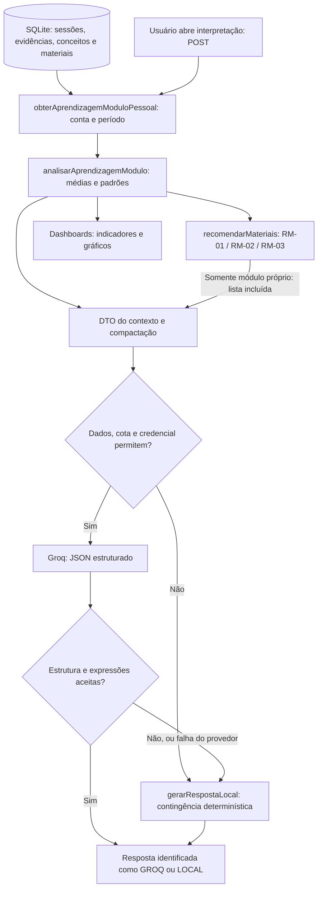

# Auditoria documental — Lógica de recomendações e encaminhamento à IA

Data: **28/10/2026**. Escopo: implementação disponível em `C:\Codigos\TCC`.

Esta foi uma auditoria somente de leitura. Foram inspecionados código, testes existentes e artefatos históricos; não foram executados testes, serviços da aplicação, migrações, seed, build ou chamadas à Groq. Foi criado somente este relatório, na raiz conforme solicitado. Código, banco, configurações, prompts, corpus, rubricas, relatórios anteriores e alterações locais preexistentes foram preservados.

### Convenção de rastreabilidade

As referências abreviadas abaixo identificam arquivos; os intervalos indicados no texto são linhas da versão examinada. Uma **regra implementada** é sustentada pelo código. Um **teste documental** mostra uma entrada e uma asserção já existentes, sem alegar execução nesta auditoria. Um **registro histórico** conserva dados de uma execução anterior. **Não confirmado** significa que não foi localizado um caminho ativo suficiente, não uma prova de inexistência em todas as versões.

| Ref. | Arquivo | Funções/componentes centrais |
|---|---|---|
| R | [recomendacoes-materiais.ts](src/dominio/analises/recomendacoes-materiais.ts) | `recomendarMateriais`, linhas 15–49. |
| RT | [recomendacoes-materiais.test.ts](src/dominio/analises/recomendacoes-materiais.test.ts) | Casos de seleção, isolamento, deduplicação, amostra e exploração, 4–32. |
| A | [aprendizagem-modulo.ts — servidor](src/servidor/aprendizagem-modulo.ts) | `sincronizarConceitosMaterial`, 27–60; `registrarEvidenciaDoMaterial`, 89–110; `obterAprendizagemModuloPessoal`, 115–165. |
| D | [aprendizagem-modulo.ts — domínio](src/dominio/analises/aprendizagem-modulo.ts) | `analisarAprendizagemModulo`, 287–342; auxiliares de médias, associação, comparação, tendência e índices. |
| M | [metricas-sessoes.ts](src/dominio/analises/metricas-sessoes.ts) | `sessaoValida`, 102–107; `calcularMetricasSessoes`, 198–237. |
| MS | [metricas.ts](src/servidor/metricas.ts) | `obterMetricasSessoesModuloPessoal`, 31–40; `obterMetricasSessoesPessoais`, 43–57. |
| O | [dashboard-observacional.ts — domínio](src/dominio/analises/dashboard-observacional.ts) | `calcularDashboardObservacional`, 121 em diante; `calcularConsistenciaMetodos`, 39–72. |
| OS | [dashboard-observacional.ts — servidor](src/servidor/dashboard-observacional.ts) | `obterDashboardObservacionalPessoal`, 8–35. |
| I | [interpretacoes.ts](src/servidor/ia/interpretacoes.ts) | Construção/compactação de DTOs, 79–196; `interpretarComFila`, 217–264; geradores por contexto, 275–334. |
| P | [contrato-provedores.ts](src/servidor/ia/contrato-provedores.ts) | JSON Schema, 3–28; prompt e `criarInstrucaoInterpretacao`, 30–50; extração, 52–69. |
| V | [esquema.ts](src/dominio/interpretacoes/esquema.ts) | `DtoInterpretacao`, 8–58; `validarConteudoInterpretacao`, 93–104; `montarInterpretacao`, 106–120. |
| L | [resposta-local.ts](src/dominio/interpretacoes/resposta-local.ts) | `insightsDeAprendizagem`, 12–58; `insightDeEstrategia`, 60–75; `gerarRespostaLocal`, 89–95. |
| C | [interpretacao-automatica.tsx](src/componentes/interpretacao-automatica.tsx) | `InterpretacaoAutomatica`: requisição, 32–53; apresentação, 55–80. |
| S | [interpretacao-compartilhada.ts](src/servidor/ia/interpretacao-compartilhada.ts) | `criarDtoCompartilhado`, 7–16; `gerarInterpretacaoCompartilhada`, 18–32. |
| B | [dashboard-compartilhado.ts](src/servidor/dashboard-compartilhado.ts) | `obterDashboardCompartilhado`, 13–41. |
| AS | [aprendizagem-sala.ts](src/servidor/aprendizagem-sala.ts) | `serializarResumoAprendizagemSala`, 30–46; `obterResumoAprendizagemVinculoSala`, 48–56. |
| PS | [paineis-salas.ts](src/servidor/paineis-salas.ts) | Agregação com corte de contribuidores, 9–19; painéis autorizados, 37 em diante; `obterDashboardIndividualAutorizado`, 144–152. |

## 1. Resumo executivo

Foram identificadas quatro camadas diferentes, que não devem ser descritas como um único recomendador:

1. **Cálculo de indicadores:** funções determinísticas calculam médias, contagens, tendências, comparações percepção/desempenho e rankings exploratórios. Esses resultados não são, por si só, prescrições de estudo [D:111–127, 228–341; M:198–237].
2. **Recomendação por regras do sistema:** `recomendarMateriais` identifica sinais por médias de desempenho/compreensão/dificuldade, ordena até três conceitos e seleciona materiais relacionados. Produz RM-01, RM-02 ou RM-03, independentemente de chamada à IA [R:15–49; A:150–158].
3. **Texto da IA externa:** o modelo recebe um DTO e escreve observações, reflexões e possíveis experimentos sob instruções. Não executa as regras RM, e seu texto não é uma reprodução obrigatória de cada recomendação [I:141–155; P:32–49; V:60–70].
4. **Contingência local:** funções do projeto também produzem sugestões textuais por condições determinísticas, inclusive comparar outra estratégia. Portanto, essas sugestões **não existem somente na geração externa** [L:12–37, 60–95].

Principais conclusões para o TCC:

- A candidatura de conceito ocorre se **desempenho médio < 70% OU compreensão média < 3/5 OU dificuldade média >= 3/5**, considerando apenas campos não nulos. Os índices normalizados, a tendência, a frequência e a regularidade **não participam dessa condição RM** [R:23–28].
- **Não há bloqueio geral de recomendação por `n < 3`.** A quantidade de evidências apenas muda `nivelEvidencia` para `LIMITADA` ou `DESCRITIVA`; recomendações de material podem existir com zero, uma ou duas evidências se houver sinal nos campos disponíveis [R:24–43; RT:24–28].
- Há textos determinísticos de revisão: RM-01 fala em revisão exploratória; RM-02 solicita revisar o conceito e registrar nova evidência; RM-03 sugere registro inicial [R:29–46].
- Não foi localizada regra RM que determine trocar para um método específico por desempenho. Há, entretanto, sugestão local de comparar outra estratégia no fallback e um campo `proximoExperimento` calculado no dashboard, sem exibição ativa localizada [L:29–37; O:152–158, 255–257].
- A recomendação calculada é incluída no DTO do **módulo próprio**. Não é incluída no DTO pessoal nem no de membro de Sala; no compartilhamento direto, a lista é explicitamente esvaziada [I:141–171, 309–325; S:7–16].
- Não foi localizado painel RM integrado às páginas atuais. Existe o componente `PainelRecomendacoesMateriais`, com testes, mas seus usos localizados são o próprio arquivo e os testes. “Não há painel integrado” é fiel; “não existe implementação de painel” não é [seção 8].

## 2. Fluxo técnico de ponta a ponta

### 2.1. Registros → indicadores → regras

**a) Origem e elegibilidade.** `obterAprendizagemModuloPessoal` consulta um módulo com `usuarioId` correspondente, `arquivado: false` e `rascunho: false`. Seleciona conceitos ativos, materiais ativos, sessões e evidências. Evidências vinculadas a recurso só são elegíveis pela consulta se o recurso estiver ativo e tiver função `AVALIACAO`; evidências sem recurso também podem participar [A:115–128].

As sessões precisam estar concluídas, possuir encerramento, duração inteira e **>= 5 minutos**. Arquivamento da sessão não é exclusão analítica. No serviço A, o recorte inicial usa `iniciadaEm >= inicio` e `iniciadaEm <= referencia`; o domínio também exige `encerradaEm <= referencia`. Evidências usam `dataEvento >= inicio`, quando há início, e `dataEvento <= referencia` [M:102–107, 221–234; A:131–150; D:293–295].

O fim/referência é o parâmetro de consulta ou o instante atual. Sem início, não existe uma janela universal de 90 dias para o recomendador. Os filtros de data da interface são resolvidos em [periodo-modulo.ts](src/dominio/periodo-modulo.ts), `resolverPeriodoModulo`, 23–35: início às 00:00 UTC, fim às 23:59:59,999 UTC para datas informadas; sem datas, início nulo e fim no instante atual.

**b) Vínculos com conceitos.** Sessões acumulam conceitos explicitamente vinculados, conceitos dos materiais associados e conceitos cujo nome/alias aparece na descrição por correspondência textual. Evidências acumulam conceitos diretos e de suas questões. A seleção de material recomendável posteriormente ocorre por **ID de conceito**, não por nova busca semântica [A:129–149; D:75–108]. A sincronização de conceitos extraídos e seus vínculos com materiais está em `sincronizarConceitosMaterial` [A:27–60].

**c) Cálculos.** `analisarAprendizagemModulo` filtra evidências com percentual não nulo, finito, **>= 0 e <= 100**, data válida e não posterior à referência; deduplica por ID. Agrupa sessões/evidências por conceito e calcula médias simples. Ausência de valores produz `null` [D:97–99, 283–322].

**d) Decisão RM.** O serviço converte `analises.conceitos` em `ConceitoRecomendacao`, conservando `id`, `nome`, três médias e `evidencias`. Somente conceitos encontrados no catálogo ativo são encaminhados. Em seguida chama `recomendarMateriais` com os materiais ativos cuja função é `REFERENCIA` [A:151–158].

**e) Resultado de servidor.** A função retorna `{ recomendacoes, conceitos, evidencias, analises, linhaDoTempo, base }`. A criação das recomendações ocorre quando o serviço é consultado, inclusive no carregamento de páginas; não depende de disparar o modelo [A:159–165]. A página do módulo chama esse serviço no carregamento [src/app/modulos/[identificador]/page.tsx](src/app/modulos/[identificador]/page.tsx), `PaginaModulo`, 78–87.

**f) Solicitação de interpretação.** Ao clicar no botão, `abrir` mostra o modal e chama `gerar`, que faz um POST. O servidor consulta novamente os indicadores e monta o DTO do contexto. Não foi localizado um processo autônomo em segundo plano que envie essas recomendações à Groq sem solicitação desse fluxo [C:32–40, 67–74; I:275–305].



O diagrama resume chamadas internas, não microsserviços. A seta de recomendações ao DTO não se aplica indistintamente a todas as telas [I:141–171, 309–325; S:15].

### 2.2. Diferenças entre telas

| Contexto | Cálculo/carregamento automático | Disparo e conteúdo efetivo da interpretação | Evidência |
|---|---|---|---|
| Dashboard pessoal | `obterDashboardObservacionalPessoal` consulta sessões e aprendizagem dos módulos, mas passa ao domínio os campos de `analises`, não as listas RM. | POST `/api/interpretacoes` → `gerarInterpretacaoPessoal` → `criarDtoInterpretacaoPessoal`. Métricas de sessões, autorrelatos, métodos/formatos, evolução e descrições; **sem `aprendizagemModulo` e sem `recomendacoes`**. | OS:19–34; I:158–171, 275–286; C:39. |
| Módulo próprio | A página consulta métricas e aprendizagem; o serviço calcula as recomendações. | POST `/api/modulos/[identificador]/interpretacoes` → `gerarInterpretacaoModuloPessoal` → `criarDtoInterpretacaoModulo`. Inclui aprendizagem conceitual, associações, padrões e lista RM. | Página:78–87, 129; I:141–155, 289–306. |
| Sala | Resumos dos vínculos reutilizam `obterAprendizagemModuloPessoal`, mas serializam apenas análises permitidas. Agregados exigem **>= 3 contribuidores**; isso não é limiar do recomendador. | A interpretação localizada é de um **membro/vínculo**, autorizada para o proprietário da Sala. `gerarInterpretacaoMembroSala` envia métricas resumidas, sem descrições, recomendações RM ou bloco conceitual `aprendizagemModulo`. Não foi localizado gerador de IA do agregado geral equivalente. | AS:30–56; PS:9–19, 37 em diante, 144–152; I:309–334; [interpretacao-membro.tsx](src/app/salas/interpretacao-membro.tsx), `gerar`, 13–21. |
| Módulo compartilhado diretamente | `obterDashboardCompartilhado` reutiliza métricas e aprendizagem do proprietário e devolve projeção de leitura, sem lista RM. | POST `/api/compartilhamentos/modulos/[moduloId]/interpretacoes` → `gerarInterpretacaoCompartilhada`. Preserva análises, mas passa `recomendacoes: []`, `linhaDoTempo: []`, `evidencias: []` e nenhuma descrição. A cota é do convidado; o acesso é verificado antes e depois da operação. | B:13–41; S:7–32; I:51–60. |

**Ressalva temporal no Dashboard pessoal:** a página passa `inicio` e `fim` ao componente, mas C:39 não acrescenta `consulta` à URL pessoal, apenas às URLs de módulo e módulo compartilhado. A [rota pessoal](src/app/api/interpretacoes/route.ts), `POST`, 7–16, aceita os parâmetros quando presentes; no acionamento atual do botão eles não são enviados. Portanto, não afirmar que a interpretação pessoal necessariamente respeita o filtro visual ativo. Este é um achado estático; não foi corrigido nem verificado por nova requisição [C:36–40; página [dashboard/page.tsx](src/app/dashboard/page.tsx):19–29].

## 3. Indicadores efetivamente consumidos pelas decisões

### 3.1. Entradas reais das regras RM

| Indicador/campo | Cálculo e origem | Escala, janela e suficiência | Consulta na decisão | Evidência |
|---|---|---|---|---|
| `desempenhoMedio` | Média simples dos percentuais de evidências válidas distintas do conceito. | 0–100%; recorte do serviço, não uma janela fixa de 90 dias. Uma evidência já permite média. Sem evidência válida: `null`. | Candidato se não nulo e **< 70**; prioridade 0 se < 70; ordenação ascendente depois da prioridade. | D:`media`,97–99; `evidenciaValida`,283–284; `analisarAprendizagemModulo`,295–322; A:144–155; R:23–28. |
| `compreensaoMedia` | Média simples dos autorrelatos não nulos das sessões associadas ao conceito. | Escala original 1–5; sem normalização na condição RM. Não há mínimo de três autorrelatos nessa média por conceito. Uma observação permite média; nenhuma: `null`. | Candidato se não nulo e **< 3**. | D:306–317; A:131–155; R:26. |
| `dificuldadeMedia` | Média simples dos autorrelatos não nulos de dificuldade por conceito. | Escala original 1–5; mesma seleção temporal. Uma observação permite média; nenhuma: `null`. | Candidato se não nulo e **>= 3**. | D:317; R:27. |
| `evidencias` | Tamanho do mapa de evidências válidas distintas do conceito. | Contagem inteira; zero não impede sinal por autorrelato. | `tamanhoAmostra`; **>= 3 → DESCRITIVA**, **< 3 → LIMITADA**. Não elimina candidato nem impede RM-01. | D:295–315; A:155; R:42–43; RT:24–28. |
| `id`, `usuarioId`, `moduloId`, `conceitoIds`, `disponivel` | Metadados de catálogo, propriedade e vínculo dos materiais. | Não são indicadores de aprendizagem. Materiais ativos de função `REFERENCIA` chegam ao domínio com `disponivel: true`. | Correspondência por conceito, conta, módulo, disponibilidade e não repetição do material. | A:119–123,153–157; R:35–38. |

A validação ordinária dos autorrelatos de sessão exige inteiro **>= 1 e <= 5**: [src/servidor/sessoes.ts](src/servidor/sessoes.ts), `campoPercepcao`, linha 19 e esquemas 37–43. As funções de domínio recebem dados tipados e ignoram campos nulos, mas não repetem toda essa validação de entrada em cada média [D:306–317].

**Distinção importante:** as métricas gerais de sessão ocultam médias de percepção com menos de **duas** observações elegíveis; no resumo global exigem ambas as percepções não nulas. Já as médias por conceito usadas por RM não reutilizam esse bloqueio. Logo, não transferir o mínimo de M para a condição de R [M:4,154–161,198–216; D:306–317].

### 3.2. Indicadores analisados, mas não usados pelo seletor RM

| Indicador | Comportamento implementado | Participa de RM-01/02/03? | Outro destino / evidência |
|---|---|---|---|
| Índices de compreensão/dificuldade por conceito | `N(x)=((x−1)/4)×100`. Índice de dificuldade = média dos sinais disponíveis `N(dificuldade)`, `100−N(compreensão)`, `100−desempenho`; índice de compreensão usa os complementos correspondentes. Janela inclusiva dos últimos **90 dias**, respeitando os dados já recortados; pelo menos **duas observações**, contadas como sessões com alguma percepção + evidências. Ordena maior índice, mais recente, mais observações e nome; até cinco conceitos. | **Não.** O serviço usa `analises.conceitos`, não os rankings. | `classificarConceitosRecentes`, D:228–280; A:153–155. Os índices são exibidos por painéis de conceito, não representam probabilidade de domínio. |
| Tendência por conceito | Pelo menos **três evidências**. Variação = último percentual − primeiro, em pontos percentuais: **>= 10 → EVOLUCAO_POSITIVA**; **<= −10 → PONTO_DE_ATENCAO**; **−10 < variação < 10 → ESTAVEL**. Com menos de três: `DADOS_INSUFICIENTES`. | **Não.** Não há leitura de `tendencia` em R. | `tendenciaEvidencias`, D:121–127; DTO I:119–127. Não é regressão estatística nem teste de significância. |
| Relação percepção/evidência | Compreensão e desempenho não nulos e **n >= 3 evidências**. “Alta” = **N(compreensão) >= 70** e/ou **desempenho >= 70**. Ambos altos: alinhamento; só percepção alta: possível superestimação; só desempenho alto: possível subestimação; nenhum alto: atenção. | **Não diretamente.** Usa os mesmos dados básicos, mas outro limiar de compreensão. | `estadoPercepcaoEvidencia`, D:111–118; padrões D:335–340; fallback L:15–26. `N(compreensão)>=70` equivale algebricamente a média >= 3,8; não é o corte RM `<3`. |
| Resultados por método/formato | Agrupa sessões e evidências por contexto, deduplicando evidência por ID. A suficiência é **>= 3 evidências posteriores**; a média pode existir antes, acompanhada do indicador de insuficiência. | **Não.** | D:`agruparResultadosPorContexto`,130–158; DTO I:128–130; fallback baixo desempenho L:29–37. |
| Vínculo de evidência posterior | Exige data da evidência **> encerramento** da sessão. Se existe vínculo explícito, só a sessão vinculada participa. Sem vínculo explícito, exige conceito comum e diferença **<= 30 dias**. | Não é filtro próprio de R; determina associações por contexto, não a média geral do conceito. | `evidenciasPosterioresDaSessao`, D:160–173. |
| Maior compreensão por contexto / duração associada | Destaque de método/formato exige **>= 3 compreensões** e média disponível; sessão de “melhor resultado” exige compreensão **>= 4/5** e média posterior **>= 70%**. | **Não.** | D:176–197; O:96–118. São destaques descritivos, não ordem de trocar método. |
| Frequência e regularidade | Contagem de dias/sequência; regularidade = semanas ativas / semanas entre primeira e última. Sem sessão: `SEM_DADOS`; menos de duas semanas: `INSUFICIENTE`; depois, proporção **>= 0,75 → CONSTANTE**, **>= 0,5 → MODERADA**, caso contrário `ESPORADICA`. | **Não.** | M:`calcularFrequencia`,115–128; `calcularRegularidade`,130–137. Parte dessas métricas vai ao DTO, não à condição RM. |
| Consistência entre módulos | Por contexto, exige compreensão e desempenho disponíveis, **>= 3 compreensões e >= 3 evidências** no módulo. Módulo positivo: compreensão >= 4 e desempenho >= 70. Marca poucos dados se módulos analisáveis **< 2 OU evidências < 4**. | **Não.** | O:`calcularConsistenciaMetodos`,39–72. Não é regra de seleção de material. |

Não se deve afirmar que todos os indicadores calculados “acionam recomendações”: a função R recebe somente as três médias, a quantidade de evidências e os metadados necessários à seleção [R:1–17].

## 4. Catálogo das regras reais

### 4.1. Regras de materiais e classificação analítica

Na tabela, P = desempenho médio em %, C = compreensão média em 1–5, Df = dificuldade média em 1–5 e n = evidências válidas do conceito. Cada comparação exige que seu campo não seja `null`.

| Regra / componente | Condição exata | Ação / saída | Sem dados suficientes | Destino | Evidência (arquivo:linhas) |
|---|---|---|---|---|---|
| Candidatura RM | `(P != null E P < 70) OU (C != null E C < 3) OU (Df != null E Df >= 3)`. | Inclui conceito na lista de atenção do seletor. | Não exige n mínimo; um sinal disponível é suficiente. Todos nulos não acionam. | Ordenação RM. | R:`recomendarMateriais`,23–28; A:153–155. |
| Ordenação e limite RM | Prioridade 0 para P não nulo <70; 1 para demais. Depois menor P, com `null` substituído por 100 para ordenar; depois ID crescente por `localeCompare`. | Processa os **três primeiros conceitos**, no máximo. | Falta de material não promove automaticamente o quarto conceito. | Seleção de um material por conceito. | R:23–28,34–37. |
| RM-01 | Conceito entre os selecionados e existe material elegível ainda não usado. | `tipo:MATERIAL`, IDs e título, texto de revisão exploratória. | Pode ocorrer com n=0/1/2, marcado limitado; não é recomendação validada por três evidências. | Retorno do serviço e DTO de módulo próprio. | R:35–46; I:153; RT:9–14,24–28. |
| RM-02 | Conceito selecionado e nenhum material elegível restante. | `tipo:SEM_MATERIAL`, IDs do conceito/módulo, material e título nulos; texto “Revise o conceito e registre nova evidência de desempenho.” | Conserva a classificação limitada/descritiva conforme n. | Mesmo retorno/DTO. | R:36–46; RT:16–19. |
| RM-03 | **Zero conceitos candidatos**, não necessariamente zero dados. | Um item `EXPLORACAO`, sem conceito/material, amostra 0, nível limitado; pede sessão e evidência. | Usa a mesma mensagem para início a frio e para indicadores sem sinal de atenção. | Mesmo retorno/DTO. | R:29–33; RT:29–32. |
| Nível de evidência RM | n **>= 3**. | `DESCRITIVA`; caso contrário `LIMITADA`. | **Rotula, não bloqueia** seleção. | Campo da recomendação. | R:42–43; RT:24–28. |
| Comparação percepção/evidência | C e P disponíveis e n>=3; cortes normalizados >=70, conforme seção 3.2. | Estado categórico do conceito. | `DADOS_INSUFICIENTES` se faltar média ou n<3. | Análise e DTO; não seleciona material. | D:`estadoPercepcaoEvidencia`,111–118; I:119–127. |
| Tendência | n>=3; delta >=10 / <=−10 / entre os cortes. | Positiva / atenção / estável. | `DADOS_INSUFICIENTES` com n<3. | Análise e DTO. | D:`tendenciaEvidencias`,121–127. |
| Padrão textual objetivo | Primeiro testa estado `POSSIVEL_SUPERESTIMACAO`; depois `PONTO_DE_ATENCAO`; depois tendência `EVOLUCAO_POSITIVA`. | Um texto padronizado por conceito, em ordem de prioridade por retornos imediatos. | Sem condição correspondente, não produz item daquele conceito; pode retornar lista vazia. | `padroesObjetivos` no DTO de módulo. | D:`analisarAprendizagemModulo`,335–340; I:132. |
| Ponto de atenção do dashboard | Média recente de dificuldade disponível e **>=3**; média geral de sessão depende de pelo menos duas observações elegíveis. | Escolhe módulo por maior dificuldade, maior amostra e título crescente. | Retorna `null` quando nenhum elegível; interface mostra ausência de ponto suficiente. | Card do dashboard pessoal. | O:159–163; M:198–215; [cartoes-insights-dashboard.tsx](src/componentes/cartoes-insights-dashboard.tsx),13,29–31. |
| `proximoExperimento` | Existe ao menos **uma sessão válida** e **um módulo**. | Escolhe, entre os métodos cadastrados, o de menor quantidade de sessões; empates mantêm o primeiro na ordem do catálogo. | `null` sem sessão/módulo. Não exige comparação de desempenho. | Campo calculado/retornado; não foi localizada exibição ou inclusão nos DTOs atuais. | O:152–158,255–257; [metodos.ts](src/dominio/sessoes/metodos.ts),4–11. |

`proximoExperimento` é uma regra implementada, mas não confirma uma funcionalidade visível de recomendação de método. A ordem do catálogo é Feynman, recuperação ativa, repetição espaçada, Pomodoro, Intercalamento e prática distribuída; não é uma hierarquia de eficácia [metodos.ts:4–11; O:152–158].

### 4.2. Fallback: decisões que também redigem sugestões sem modelo externo

| Regra / componente | Condição exata | Ação / saída | Sem dados suficientes | Destino | Evidência (arquivo:linhas) |
|---|---|---|---|---|---|
| Sem sessões | `quantidadeSessoesValidas === 0`. | Um insight local de formação de base; sugere registrar sessão. | Não compara métodos nem usa material recomendado. | Resposta `LOCAL`. | L:`insightSemDados`,3–9; `gerarRespostaLocal`,89–94. |
| Calibração | Primeiro conceito com relação `POSSIVEL_SUPERESTIMACAO` e médias C/P não nulas. | Texto sobre discrepância e sugestão de recuperar/aplicar conteúdo antes de consultar material. | Depende do estado calculado, que exige n>=3 no fluxo normal. Confiança forte se n>=5, moderada se n>=3, baixa nos demais valores recebidos. | Insight `CALIBRACAO`. | L:`insightsDeAprendizagem`,15–26; D:111–118. |
| Comparar outra estratégia | Primeira associação com sessões **>=3**, `amostraSuficiente === true`, desempenho posterior não nulo e **<60%**. | Sugere comparar uma próxima sessão com outra estratégia, mantendo conteúdo/duração próximos. Não escolhe qual estratégia substituirá a atual. | Sem candidato, não produz esse insight. Forte se evidências>=5; caso contrário moderada. | Insight local `ESTRATEGIA`. | L:29–37; I:128–130. |
| Reobservar método | Existe método com compreensão média não nula; ordena por maior número de sessões, depois nome. | Seleciona o primeiro e sugere novo teste em conteúdo comparável. | Compreensões **<3**: hipótese inicial e confiança baixa; **>=5**: forte; demais: moderada. | `insightDeEstrategia` local. | L:60–75. |
| Base geral | Há sessões, mas nenhuma das regras produziu insight. | Texto descritivo e sugestão de continuar registrando. | Confiança moderada se sessões>=5, baixa se <5. | `insightGeral` local. | L:77–94. |

O fallback acumula primeiro os insights de aprendizagem, acrescenta o insight de estratégia, remove nulos e aplica **`slice(0,3)`**. Não consulta `dto.recomendacoes`: a lista RM não determina suas frases [L:12–95]. Assim, o corte RM de 70% e o corte local de 60% têm funções diferentes.

Há ainda duas condições em L:39–56: `evolucaoAprendizagem.length >= 3` e último valor **> primeiro**; e `bloom.compreender − bloom.analisar >= 20` pontos percentuais. Esses campos opcionais aparecem no tipo V:55–56 e em [insights-aprendizagem.test.ts](src/servidor/ia/insights-aprendizagem.test.ts):104–114. **Não foi localizado preenchimento desses campos pelos construtores atuais dos quatro contextos auditados** [I:141–171,314–325; S:15]. São ramos implementados e testados documentalmente, não funcionalidade de Bloom ou progresso numérico confirmada no fluxo vivo dessas telas.

### 4.3. Seleção dos materiais e objeto de saída

O serviço fornece apenas materiais **ativos**, do módulo autorizado, com função `REFERENCIA`. O domínio verifica novamente `usuarioId`, `moduloId`, `disponivel`, ID do conceito em `conceitoIds` e ausência do material em `materiaisSelecionados`. Escolhe o **primeiro por ID crescente**, não o mais recente, mais usado, de melhor resultado ou de formato preferido [A:119–123,157; R:34–38].

É um material por conceito e até três conceitos. Um material com vários conceitos não aparece duas vezes na mesma lista; isso pode produzir RM-02 para um conceito se seu único material já tiver sido consumido por outro [R:34–46; RT:20–22].

**Não há nesse seletor:** ranqueamento semântico, embeddings, busca vetorial, score de relevância, predileção por formato, controle de dificuldade das atividades ou acesso a materiais de outros usuários. A seleção usa vínculos de conceito previamente persistidos, não inferência de relevância em tempo de recomendação [R:5–6,18–21,36–37; A:53,157].

Duas limitações concretas:

- O serviço usa `modulo.materiais`, e não `materiaisNoPeriodo`, ao chamar R. Portanto, as médias respeitam o recorte temporal, mas um material ativo de referência **não é excluído da recomendação por estar fora do intervalo de datas** [A:144–158].
- `disponivel:true` é preenchido a partir da lista consultada; nessa passagem não há verificação física de arquivo, teste de URL nem checagem da situação de análise do material. “Elegível pelas regras” não deve ser traduzido como “arquivo testado e disponível para download” [A:123,157; R:36].

O objeto `RecomendacaoMaterial` possui: `tipo`, `moduloId`, `conceitoId`, `materialId`, `tituloMaterial`, `regraId`, `indicadoresUtilizados`, `tamanhoAmostra`, `justificativaEstruturada`, `limitacoes`, `nivelEvidencia` [R:8–14,29–46]. Não é um agendamento, tarefa criada, notificação, mudança de método ou alteração de registro do estudante.

## 5. Respostas às cinco perguntas centrais do professor

Para organizar a orientação, as questões da especificação foram consolidadas nos cinco eixos abaixo; os demais detalhes estão nas seções técnicas correspondentes.

**1. Quais indicadores transformaram-se em decisões concretas?**

No seletor de materiais, somente três médias por conceito acionam candidatura: desempenho <70%, compreensão <3/5 ou dificuldade >=3/5, com condições nulas explicitamente ignoradas. A quantidade de evidências determina o rótulo da base, não a permissão de selecionar material. Índices exploratórios, tendência e frequência não são entradas dessa decisão; servem a indicadores, padrões e/ou outras camadas [R:1–49; seção 3].

**2. O que foi recomendado por regras e o que foi escrito pela IA?**

RM-01 constrói recomendação de revisão exploratória com material; RM-02 pede revisão e nova evidência sem material elegível; RM-03 propõe registro inicial. Portanto, **“revisar conceito” existe como texto determinístico**. Não foi localizada regra RM que imponha “trocar método X por Y”. O modelo pode formular experiências em `experimentoSugerido`, sob o prompt; o fallback também sugere comparar estratégias e recuperar conteúdo. “Testar outra metodologia” não é exclusivamente IA, mas não há rotina confirmada que execute a troca ou crie um experimento persistido automaticamente a partir dessas sugestões [R:32,45–46; L:24,29–37,72; P:40–42; V:60–70].

**3. Como o sistema escolheu conceito e material?**

Filtrou conceitos pelos três sinais, priorizou baixo desempenho, ordenou por média e ID, limitou a três e procurou uma referência ativa do mesmo usuário/módulo vinculada pelo ID do conceito. Empates de material foram resolvidos pelo ID, com proibição de repetir material na mesma lista. Não houve evidência de escolha por superioridade de formato [R:23–46; A:151–158; RT:9–22].

**4. O que aconteceu quando faltaram dados?**

Sem valores, as médias ficaram nulas. Sem candidato, RM-03 retornou exploração, inclusive quando havia muitos dados sem sinal de atenção. Com poucos dados e algum sinal, RM-01/02 ainda puderam existir com `LIMITADA`. Comparação e tendência bloquearam classificação com menos de três evidências, mas esse bloqueio não foi aplicado ao recomendador. Sem sessões válidas, a interpretação respondeu localmente sem chamar provedor [D:97–127; R:24–43; I:223–226; L:89–94].

**5. Como a decisão chegou à IA e ao usuário?**

No módulo próprio, o servidor incorporou a lista em `recomendacoes`, compactou o DTO e o inseriu no prompt. A Groq devolveu insights estruturados; a plataforma validou formato e expressões e exibiu a interpretação. Não há painel RM integrado localizado, e os demais contextos não recebem a mesma lista. Se as condições de acesso impedirem a operação, o fluxo retorna erro de autorização; se houver insuficiência, falta de credencial ou falha da IA, pode retornar contingência local [I:141–196,217–334; P:32–69; V:93–120; C:32–80; S:7–32].

### Casos-limite documentados

| Situação | Comportamento efetivo e camada | Evidência |
|---|---|---|
| Zero sessões e zero evidências do conceito | Sem grupo analítico observado, não há candidato; RM-03. Interpretação com zero sessões retorna `LOCAL/DADOS_INSUFICIENTES`. | D:296–306; R:29–33; I:223; L:89–94. |
| Uma sessão com percepção baixa/alta dificuldade, sem evidência | A média por conceito pode existir; RM pode selecionar material, com n=0 e `LIMITADA`. Não há bloqueio RM por número de sessões. | D:306–317; R:24–43; RT:24–28. |
| Uma ou duas evidências | Média de desempenho pode existir e acionar RM; tendência e comparação retornam `DADOS_INSUFICIENTES`. | D:111–127,306–320; R:25,43. |
| Percepção nula e desempenho válido | A comparação é insuficiente, mas desempenho <70 ainda pode acionar recomendação. | D:112; R:25–27. |
| Desempenho nulo e percepção disponível | Não participa da condição de desempenho, mas compreensão <3 ou dificuldade >=3 pode acionar. | R:25–27. |
| Todos os campos nulos | Nenhuma condição RM aciona; RM-03. | R:24–33. |
| Conceito sem observação / ausente do catálogo ativo | Conceito só catalogado, mas sem grupo de sessão/evidência, não entra em `analises.conceitos`; se não corresponder ao catálogo ativo, o serviço não o encaminha ao recomendador. | D:296–306; A:122,153–155. |
| Nenhum material ou material já usado por outro conceito | RM-02, não criação de material nem envio de arquivo alternativo. | R:34–46. |
| Dados suficientes, estáveis e bons | Estabilidade significa delta entre −10 e 10, não “bom”. Sem sinal RM, retorna RM-03; com dificuldade>=3, mesmo estável e alto desempenho pode haver candidatura. | D:121–127; R:24–33. |

Esses casos são leituras das condições e dos testes existentes, não novos experimentos. A proteção contra recomendação indevida é **parcial**: há limitação textual e identificação de base restrita, mas não uma garantia geral de abstenção com n pequeno [RT:24–28; R:43].

## 6. Encaminhamento à IA: DTO, prompt, validação e fallback

### 6.1. Disparo, busca e DTO

`InterpretacaoAutomatica.abrir` abre o diálogo e dispara `gerar`; este efetua POST. No módulo próprio, a rota autentica, resolve o período e chama `gerarInterpretacaoModuloPessoal`. O serviço consulta métricas, sessões e aprendizagem e usa `criarDtoInterpretacaoModulo` [C:32–40,67–74; [rota do módulo](src/app/api/modulos/[identificador]/interpretacoes/route.ts),`POST`,7–18; I:289–302].

Campos reais: `escopo`, `versaoAlgoritmo`, `quantidadeModulos`, `quantidadeSessoesValidas`, `minutosValidos`, `periodo`, `modulos`, `evolucaoSemanal`, `descricoesSessoes`, `limitacoes`; no módulo com aprendizagem, também `aprendizagemModulo` e `recomendacoes` [V:8–58; I:141–171].

O bloco conceitual contém `base`, `conceitos`, `associacoes`, `padroesObjetivos`, `eventosRecentes` e `evolucaoPercepcaoEvidencia`. `conceitos` inclui compreensão, desempenho, `relacaoPercepcaoEvidencia` e tendência, mas **não envia os índices compostos dos rankings** como campos desse mapeamento. A dificuldade do conceito pode estar em `recomendacoes[].indicadoresUtilizados` e nos autorrelatos, embora não conste de `aprendizagemModulo.conceitos` [I:112–153; R:1–3].

### 6.2. Compactação e limites exatos

`prepararDtoParaProvedor` conserva o objeto e aplica cortes determinísticos, não sumarização por outro modelo [I:174–196]:

| Campo / controle | Corte implementado | Evidência |
|---|---|---|
| `evolucaoSemanal` | Últimos 12 itens. | I:183. |
| `descricoesSessoes` | Últimas 10; conteúdo de cada descrição limitado a 360 caracteres, com reticência quando necessário; delimitadores de conteúdo não confiável são recolocados. | I:17–18,174–184. |
| `aprendizagemModulo.conceitos` | Primeiros 12. A ordem vem do domínio: mais evidências, mais sessões, nome. Não é ordenação de risco. | I:188; D:322. |
| `associacoes` | Primeiros 12, com métodos antes de formatos no mapeamento. | I:128–130,189. |
| `padroesObjetivos` | Primeiros 8. | I:190. |
| `eventosRecentes` | Mapeamento inicial até 20; compactação reduz para 10. | I:133–136,191. |
| `evolucaoPercepcaoEvidencia` | Últimos 12. | I:192. |
| `recomendacoes` | Não é removida/reescrita nessa compactação; a lista RM já é limitada a três conceitos. | I:180–195; R:35. |
| Entrada total | Se `JSON.stringify(dtoProvedor).length > 50_000`, contingência `ENTRADA_EXCEDIDA`. É comprimento de string em JavaScript, não limite de tokens nem tamanho do prompt completo. | I:16,224–225. |

As descrições são delimitadas como `<descricoes_nao_confiaveis>…</descricoes_nao_confiaveis>`, e nomes de módulos pessoais são referenciados por aliases como `Módulo 1`. Isso não torna todo DTO anônimo: o módulo próprio pode incluir títulos de eventos, nomes de conceitos e IDs/títulos das recomendações. As sanitizações dos contextos compartilhados são diferentes [I:97–153,158–169; S:15].

### 6.3. Prompt realmente utilizado

`criarInstrucaoInterpretacao` concatena `PROMPT_BASE`, a frase “Contexto estruturado calculado pelo sistema:” e `JSON.stringify(dto)`. O adaptador envia essa mensagem com papel `user`, não com uma mensagem de sistema separada [P:32–50; [openai-compativel.ts](src/servidor/ia/openai-compativel.ts),`criarProvedorOpenAiCompativel`,46–58].

Trechos literais relevantes do prompt, não regras inventadas nesta auditoria:

> O sistema já calculou todas as médias, contagens, tendências, diferenças e níveis de amostra. Não recalcule métricas.

> As recomendações estruturadas foram selecionadas por regras: não altere materialId, conceitoId, moduloId, indicadores, amostra ou nível de evidência; explique somente a decisão fornecida.

> Não invente dados. Não transforme associação em causalidade. Não faça diagnóstico, não rotule a pessoa, não use estilos fixos de aprendizagem e não declare um método ou formato como melhor, eficaz ou eficiente.

Esses trechos estão em P:36. O prompt também exige explicitar pouca base, tratar o resultado como hipótese, não seguir instruções das descrições, responder em português e somente em JSON. Permite de um a três insights, pergunta reflexiva quando útil e experimento simples; a ordem de temas é uma instrução de priorização textual, **não uma condição RM executada pelo servidor** [P:38–46].

### 6.4. Provedor e modelo atual versus experimento histórico

O catálogo ativo contém somente **Groq**, padrão `openai/gpt-oss-20b`, substituível por `GROQ_MODEL` se a variável satisfizer o padrão de caracteres do catálogo. A leitura local restrita à variável de modelo encontrou `GROQ_MODEL` não definida; o modelo resolvido por esse catálogo é, portanto, **`openai/gpt-oss-20b`** [catalogo-provedores.ts](src/servidor/ia/catalogo-provedores.ts),`modeloAmbiente`/`montarCatalogoProvedores`,6–23.

A credencial é recuperada da configuração global da conta ADMIN, ativa e sem bloqueio vigente (`bloqueadaAte` nula ou **<= agora**). O modelo da chamada vem do catálogo. Não foram lidos ou expostos valores de credenciais nesta auditoria [configuracoes.ts](src/servidor/ia/configuracoes.ts),`listarCredenciaisAtivas`,18,82–93; I:202–203].

O adaptador usa HTTPS em `https://api.groq.com/openai/v1/chat/completions`, com `fetch` no servidor, `temperature:0.35`, `max_completion_tokens:700`, JSON Schema estrito e `reasoning_effort:low`; timeout de **12.000 ms** no padrão [groq.ts](src/servidor/ia/groq.ts),`criarProvedorGroq`,4–12; [openai-compativel.ts](src/servidor/ia/openai-compativel.ts),`chamar`,26–43 e `interpretar`,48–62].

Na avaliação histórica, o corpus [real-groq-gpt-oss-120b-20261018-165231.json](AiFiles/RELATORIOS/avaliacao-ia-tcc/real-groq-gpt-oss-120b-20261018-165231.json) registrou **`openai/gpt-oss-120b`**. Não atribuir ao experimento o padrão atual 20b, nem atribuir ao fluxo comum o modelo 120b só porque foi usado na avaliação.

### 6.5. Formato exigido e alcance da validação

O JSON exige `insights`, com **1–3 itens**. Cada item contém `tipo`, `titulo`, `observacao`, `resumoEvidencias`, `perguntaReflexiva`, `experimentoSugerido`, `confianca`. Título: 3–100 caracteres; observação: 12–700; opcionais: texto de 3–360 ou `null`. Tipos e confiança possuem enums; o JSON Schema enviado ao provedor usa `additionalProperties:false` [P:3–28; V:4–6,60–70].

O adaptador extrai o conteúdo textual, aceita remoção de cerca Markdown e tenta interpretar o trecho entre a primeira `{` e a última `}`. `validarConteudoInterpretacao` aplica Zod e rejeita expressões como “você aprende melhor”, “melhor método/formato”, “mais eficaz/eficiente”, “estilo de aprendizagem”, “causou”, “garante” e padrões afins [P:52–69,78–88; V:93–104; adaptador:59–62].

**Limite:** não foi localizada comparação automática dos números escritos pelo modelo com o DTO, verificação semântica integral de causalidade, checagem de cada material citado ou obrigação de repetir toda recomendação RM. O esquema de saída nem pede `materialId`/`conceitoId`: a instrução de preservação desses IDs está no prompt. Zod e expressões não garantem fidelidade factual ou atendimento de C1–C5 [V:60–104; P:36].

### 6.6. Quando a contingência é acionada e o que aparece

| Condição | Resultado | Evidência |
|---|---|---|
| Sessões válidas exatamente zero | `LOCAL`, motivo `DADOS_INSUFICIENTES`; sem provedor. | I:223,279,299,326. |
| Cinco usos recentes já registrados por solicitante | Novo uso bloqueado; `COTA_LOCAL`. Janela móvel em memória: instantes com diferença **<3.600.000 ms**; máximo cinco antes do bloqueio. O consumo é anterior à consulta de credenciais, não apenas às chamadas externas bem-sucedidas. | I:14–15,37–49,275–302; S:28 e I:51–60. |
| Entrada compactada >50.000 caracteres | `ENTRADA_EXCEDIDA`. | I:224–225. |
| Nenhuma credencial elegível | `SEM_CHAVE`. | I:226; configurações:82–93. |
| Conteúdo externo inválido | Tentativa `RESPOSTA_INVALIDA`; se todas as tentativas têm esse motivo, contingência homônima. | I:234–235,248–263. |
| Falha de rede, timeout, autenticação, cota externa, modelo/requisição inválida ou indisponibilidade | Tentativa classificada; depois da fila elegível, contingência `TODOS_INDISPONIVEIS`, salvo o caso exclusivo de resposta inválida. | Adaptador:14–43; I:248–263. |

O bloqueio temporário do provedor é separado da cota local: autenticação/modelo inválido **86.400 s**; cota externa usa `retry-after` quando válido, ou **900 s**; resposta/requisição inválida **600 s**; demais **120 s**. O parser de `retry-after` considera segundos numéricos positivos, arredonda para cima e limita a **3.600 s** [I:`bloqueioParaErro`,212–215; P:`extrairRetryAfter`,71–76]. São mecanismos técnicos, não regras pedagógicas.

`montarInterpretacao` acrescenta origem, modelo, motivo, tentativas, amostra e aviso padronizado; também projeta observações em `padroesObservados` e experimentos em `conselhos`. A interface mostra carregamento/erro, identifica Groq ou “Reflexão local de contingência”, exibe observações, perguntas e sugestões quando não nulas [V:106–120; C:55–80]. A lista RM não é renderizada diretamente por esse componente.

### 6.7. Quem decide cada frase

| Conteúdo | Quem o define | Evidência |
|---|---|---|
| “Revisão exploratória…” / “Revise o conceito…” / convite ao registro inicial | Código do seletor RM, com nomes interpolados. | R:32,45–46. |
| Texto de `padroesObjetivos` | Código do domínio, conforme estado e tendência. | D:335–340; I:132. |
| Título, observação, evidência resumida, pergunta e experimento do retorno Groq | Modelo externo, sujeito ao prompt e às validações; sem catálogo exaustivo de frases imposto pelo código. | P:32–46; V:60–70. |
| Mesmos campos no retorno `LOCAL` | Templates e condições da contingência; não geração de outro LLM. | L:3–95. |
| Aviso de não causalidade, origem/modelo e contexto | Plataforma, acrescentados após a interpretação. | V:106–118; C:62. |

## 7. Exemplo rastreável de uma regra real

Fonte histórica: [corpus real](AiFiles/RELATORIOS/avaliacao-ia-tcc/real-groq-gpt-oss-120b-20261018-165231.json), experimento `real-2026-10-18T16-52-33-625Z`, execução **`S5-3`**, `execucoes[14].entrada.recomendacoes[0]`. Não houve nova geração nem recomputação do cenário.

**Entrada preservada:** conceito “Conceito”, desempenho médio **20%**, compreensão média **5/5**, dificuldade média **1/5**, **10 evidências**. O bloco `entrada.aprendizagemModulo.conceitos` também conserva esses valores disponíveis e `POSSIVEL_SUPERESTIMACAO`/`ESTAVEL`; a dificuldade está nos indicadores da recomendação e nos autorrelatos.

**Condição RM, confrontada com os valores armazenados:**

```text
20 < 70  → verdadeiro
5 < 3    → falso
1 >= 3   → falso
verdadeiro OU falso OU falso → conceito candidato
10 >= 3  → nível DESCRITIVA
```

Essas comparações explicam a regra sobre o registro, não são uma nova execução do motor [R:23–43]. O fato de o conceito também ter relação de possível superestimação **não é o predicado RM**.

**Saída realmente preservada, com seleção de campos sem alterar valores:**

```json
{
  "tipo": "MATERIAL",
  "moduloId": "cmve2d2ij0082d4vv2f5camx1",
  "conceitoId": "cmve2d2it0083d4vvis7idu5r",
  "materialId": "cmve2d2j60085d4vvania3npf",
  "tituloMaterial": "Referência do conceito",
  "regraId": "RM-01",
  "tamanhoAmostra": 10,
  "nivelEvidencia": "DESCRITIVA",
  "justificativaEstruturada": "Revisão exploratória de Conceito: há sinais de atenção neste módulo. O material aborda o conceito; sua seleção não indica superioridade de formato."
}
```

O objeto completo também preserva `indicadoresUtilizados` e `limitacoes`; eles foram omitidos do excerto apenas para concisão. A lista integral de materiais candidatos não está nesse excerto/corpus: os filtros de segurança e vínculo foram reconstruídos pelo código A/R, não por reprodução da consulta histórica.

**Destino confirmado:** o objeto consta do DTO e o prompt preservado em `S5-3` inclui o contexto JSON. A resposta final dessa posição tem origem `GROQ` e modelo `openai/gpt-oss-120b`. Isso comprova o encaminhamento da recomendação na execução, **não comprova que o modelo explicou o material selecionado**: os insights armazenados concentraram-se na divergência percepção/desempenho e em atividades de acompanhamento. Não há obrigação estrutural de citar o título ou o ID do material [registro S5-3; P:36–42; V:60–70].

Como suporte documental adicional, RT:9–14 contém uma fixture de desempenho 40, compreensão 2, dificuldade 4 e n=3, com dois materiais elegíveis de IDs `a` e `b`, e espera RM-01/material `a`. RT:24–28 verifica a classificação limitada com n=0/1/2. Esses testes foram lidos, não executados.

## 8. Divergências entre código e redação apresentada do TCC

A auditoria confrontou as afirmações fornecidas na especificação; não alterou nem verificou linha a linha uma nova versão integral do TCC.

| Afirmação acadêmica / interpretação possível | Conclusão documental | Redação fiel sugerida |
|---|---|---|
| “Todos os indicadores orientam as recomendações.” | Não confirmado para RM; somente três médias e metadados determinam a candidatura/seleção. | “O mecanismo de seleção de materiais utilizou médias por conceito de desempenho, compreensão e dificuldade; os demais indicadores apoiaram a apresentação e a interpretação.” [R:1–49]. |
| “Só houve recomendação com pelo menos três evidências.” | Diverge do código. n<3 apenas marca base limitada. | “A quantidade de evidências foi explicitada no nível da recomendação; bases com menos de três evidências foram sinalizadas como limitadas, sem bloqueio absoluto da seleção.” [R:43; RT:24–28]. |
| “Índices normalizados identificaram os conceitos para recomendar materiais.” | Os índices existem, mas não alimentam R. | “Os rankings exploratórios foram calculados separadamente; a seleção de materiais consultou as médias originais por conceito.” [D:228–280; A:153–155]. |
| “Não há painel específico de recomendações determinísticas.” | Correto sobre a composição atual, mas existe componente isolado com testes. | “As recomendações estruturadas não foram integradas a um painel específico nas páginas analisadas e foram disponibilizadas ao contexto de IA do módulo próprio.” [conteudo-dashboard-modulo.tsx](src/app/modulos/[identificador]/conteudo-dashboard-modulo.tsx),`ConteudoDashboardModulo`,6–34; [painel-recomendacoes-materiais.tsx](src/app/modulos/[identificador]/painel-recomendacoes-materiais.tsx),4–18; usos localizados apenas no arquivo/testes. |
| “O DTO inclui desempenho, tendências e recomendações em qualquer dashboard.” | Diverge entre contextos. Pessoal e Sala não incluem lista; compartilhado direto a esvazia. | “No módulo próprio, o DTO incorporou dados conceituais e recomendações; os demais contextos utilizaram projeções específicas e restrições de compartilhamento.” [I:141–171,309–325; S:15]. |
| “Sugestões de revisão ou mudança de estratégia são todas da IA.” | Falso como generalização. RM contém revisão; fallback contém comparação de estratégia; há campo calculado de próximo experimento sem integração confirmada. | “A redação externa de insights foi complementada por recomendações estruturadas e por templates locais de contingência, com responsabilidades distintas.” [R:32,45–46; L:24,29–37,72; O:156–158]. |
| “O sistema automaticamente troca o método ou agenda revisão.” | Funcionalidade não localizada no fluxo RM/insights auditado. | “Foram apresentadas sugestões textuais, sem aplicação automática de alterações aos registros de estudo.” [R:8–14; V:60–70; C:32–62]. |
| “O material selecionado foi o mais relevante ou do melhor formato.” | Não há score desse tipo; desempate por ID. | “Foi selecionado um material de referência elegível, vinculado ao mesmo conceito, com ordenação determinística por identificador.” [R:36–37]. |
| “Toda recomendação respeitou a janela de 90 dias.” | Diverge: 90 dias pertence ao ranking; materiais de referência não são filtrados por data no seletor. | “Os indicadores respeitaram o período consultado, enquanto os materiais candidatos foram os ativos de referência vinculados ao módulo e conceito.” [A:144–158; D:236–242]. |
| “A resposta JSON validada é necessariamente fiel às métricas.” | Validação estrutural e lexical não é conferência semântica/numeral. | “A resposta foi validada quanto à estrutura e a expressões restritas; sua adequação semântica permaneceu sujeita à avaliação qualitativa.” [V:93–104]. |
| “A IA do Dashboard pessoal sempre usa o filtro da tela.” | Caminho do botão não inclui parâmetros na URL pessoal, embora a API aceite. | “A integração utilizou o contexto obtido pelo endpoint de interpretação; no fluxo pessoal auditado não foi confirmado o encaminhamento do filtro visual pelo botão.” [C:36–40; rota pessoal:10–15]. |

## 9. Proposta de texto acadêmico enxuto

### Para a seção 4.3 — Processamento analítico e apresentação dos indicadores

> O processamento analítico foi realizado no servidor, a partir de sessões concluídas elegíveis e de evidências válidas, respeitando a propriedade dos dados e o período consultado. Separadamente dos rankings exploratórios, um mecanismo determinístico selecionou conceitos com desempenho médio inferior a 70%, compreensão percebida média inferior a 3 na escala de 1 a 5 ou dificuldade percebida média igual ou superior a 3 nessa escala. Os conceitos foram priorizados por baixo desempenho, com ordenação determinística e limite de três itens. Para cada conceito, o sistema procurou um material ativo de referência, do mesmo usuário e módulo, vinculado pelo identificador do conceito. Na ausência de material elegível, produziu uma orientação estruturada de revisão e registro de nova evidência; sem conceitos candidatos, retornou uma orientação inicial de exploração. A quantidade de evidências acompanhou a recomendação: bases inferiores a três foram identificadas como limitadas, sem bloqueio absoluto da seleção. As recomendações não foram integradas a um painel específico nas páginas analisadas e compuseram o contexto estruturado de interpretação do módulo próprio.

Fundamentação: A:115–165; R:23–46; RT:24–32; composição `ConteudoDashboardModulo`,6–34. Os limiares descritos são parâmetros implementados, não cortes de eficácia pedagógica demonstrada.

### Complemento para a seção 4.4 — Integração com Inteligência Artificial

> A interpretação foi solicitada pelo usuário. No contexto do módulo próprio, o servidor incorporou ao DTO os indicadores conceituais, os padrões identificados e as recomendações previamente calculadas. O contexto foi compactado e inserido em um prompt que instruiu o modelo a não recalcular métricas, inventar dados, atribuir causalidade ou definir perfis fixos de aprendizagem. A resposta estruturada foi submetida à validação de formato e de expressões restritas antes da apresentação. Em situações de insuficiência, indisponibilidade ou invalidade da resposta externa, a aplicação dispôs de uma contingência local, composta por templates e regras próprios. Os contextos pessoal e compartilhados utilizaram projeções distintas; no compartilhamento direto de módulos, as recomendações de materiais foram removidas do DTO. A validação automática não substituiu a avaliação qualitativa da fidelidade e pertinência do conteúdo.

Fundamentação: I:141–196,217–334; P:32–69; V:93–120; L:12–95; S:15. Se a seção mencionar modelos, distinguir o catálogo atual 20b do experimento histórico 120b [seção 6.4].

## 10. Tabela LaTeX sugerida para o TCC

A tabela resume regras confirmadas, sem atribuir a RM a lógica do fallback. Requer `booktabs`, `tabularx` e `array` no documento LaTeX. O código foi fornecido como texto; não foi compilado nem houve alteração de fontes do TCC.

```latex
\begin{table}[htbp]
\centering
\caption{Regras de recomendação e contingência implementadas}
\label{tab:regras-recomendacao}
\footnotesize
\begin{tabularx}{\textwidth}{@{}p{0.16\textwidth}XX@{}}
\toprule
Componente & Condição & Saída \\
\midrule
Candidatura &
$P<70\%$ ou $C<3$ ou $D\geq3$, considerando apenas
valores disponíveis &
Conceito candidato; prioridade para baixo desempenho,
com limite de três conceitos. \\
RM-01 &
Conceito selecionado e referência elegível vinculada &
Material do mesmo usuário e módulo; orientação
de revisão exploratória. \\
RM-02 &
Conceito selecionado sem referência elegível restante &
Orientação de revisão e registro de nova evidência,
sem material indicado. \\
RM-03 &
Nenhum conceito candidato &
Orientação de exploração e registro inicial,
sem conceito ou material selecionado. \\
Nível da base &
$n\geq3$ evidências válidas; caso contrário, $n<3$ &
Base descritiva ou limitada, respectivamente;
o rótulo não bloqueia RM-01 ou RM-02. \\
Contingência &
Associação com pelo menos três sessões,
base suficiente e desempenho posterior $<60\%$ &
Sugestão local de comparar outra estratégia,
sem troca automática dos registros. \\
\bottomrule
\end{tabularx}
\par\smallskip
\begin{minipage}{\textwidth}
\scriptsize
Nota: $P$ é o desempenho médio; $C$ e $D$ são médias
de compreensão e dificuldade na escala de 1 a 5; $n$
conta evidências distintas do conceito nas regras RM.
Na contingência, a suficiência da associação corresponde
a pelo menos três evidências posteriores.
A seleção não demonstrou superioridade de método ou formato.
\end{minipage}
\end{table}
```

Fontes da tabela: R:`recomendarMateriais`,23–46; D:`agruparResultadosPorContexto`,149–157; L:`insightsDeAprendizagem`,29–37. O tamanho final depende da classe e das margens do TCC; não foi declarada verificação de paginação.

## 11. Limitações das evidências e verificações futuras opcionais

1. **Auditoria estática, não reexecução:** os testes foram usados como especificações verificáveis de comportamento, não como novas aprovações. A execução histórica S5-3 é evidência persistida e separada da análise do código atual.
2. **Integração do painel RM:** o componente existe e possui testes, mas não foi localizado uso ativo na composição das páginas. Isso sustenta a redação sobre ausência de integração, não prova que nunca houve painel em versões anteriores [componente/testes citados na seção 8].
3. **Ramos opcionais e campos calculados:** `bloom`, `evolucaoAprendizagem` e `proximoExperimento` têm código implementado, mas não foi confirmado consumo visível/produção de entrada nos caminhos atuais apontados. Não os apresentar como funcionalidades ativas sem evidência adicional [seções 4.1–4.2].
4. **Suficiência não uniforme:** mínimos de duas percepções, três evidências, duas observações recentes, três compreensões de contexto e três contribuidores de Sala pertencem a finalidades diferentes. Não condensar todos em “mínimo de três dados” [M:4; D:29–38,242; PS:9–19; R:43].
5. **Validação semântica limitada:** prompt e expressões reduzem certos riscos, mas não conferem automaticamente os números e as recomendações textuais contra todas as entradas. Não foram produzidas novas respostas para demonstrar qualidade [P:36–46; V:93–104].
6. **Configuração versus serviço em execução:** a resolução do catálogo e da variável de modelo foi lida localmente, sem consultar a conta Groq, seu catálogo remoto, disponibilidade ou a configuração carregada por um processo já iniciado. O modelo histórico foi identificado pelo corpus, não inferido da configuração atual.
7. **Verificações futuras, somente se autorizadas em outra tarefa:** conferir o encaminhamento do período no botão pessoal; observar interface e cenários de dados escassos; testar limites de igualdade 70/3/60; revisar a política de abstenção com amostra pequena; avaliar fidelidade semântica das sugestões. Nenhuma dessas melhorias ou execuções foi realizada aqui.

**Resultado da auditoria:** o código implementou seleção determinística de materiais, classificação analítica e redação local de contingência, além da interpretação externa. A descrição acadêmica deve preservar essas separações, a diferença de contexto entre telas e a ausência de bloqueio geral por poucas evidências, sem atribuir ao sistema mecanismos de mudança automática de estratégia, avaliação causal ou seleção semântica que não foram confirmados.
